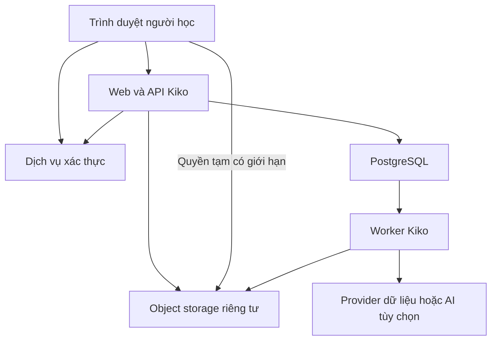
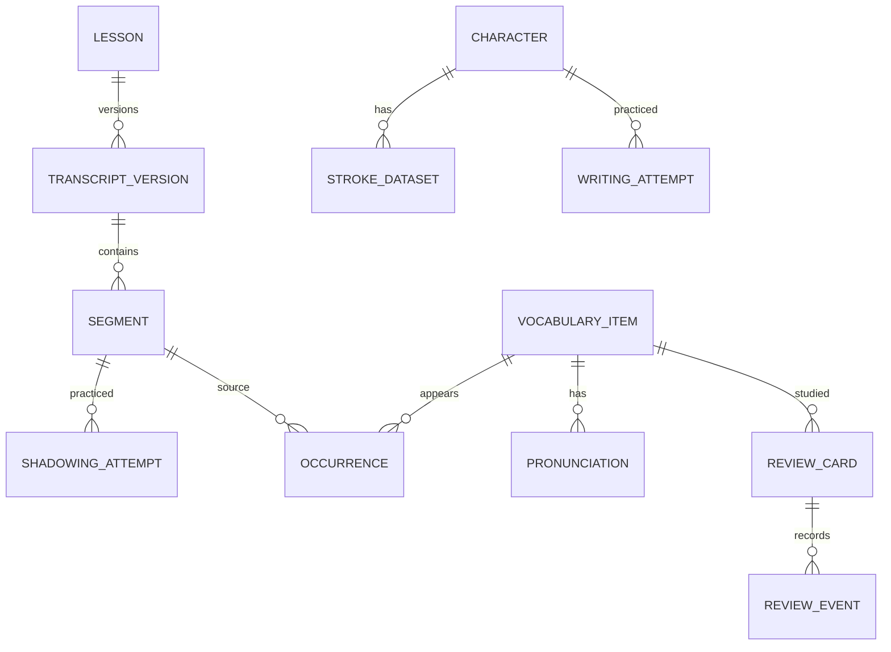
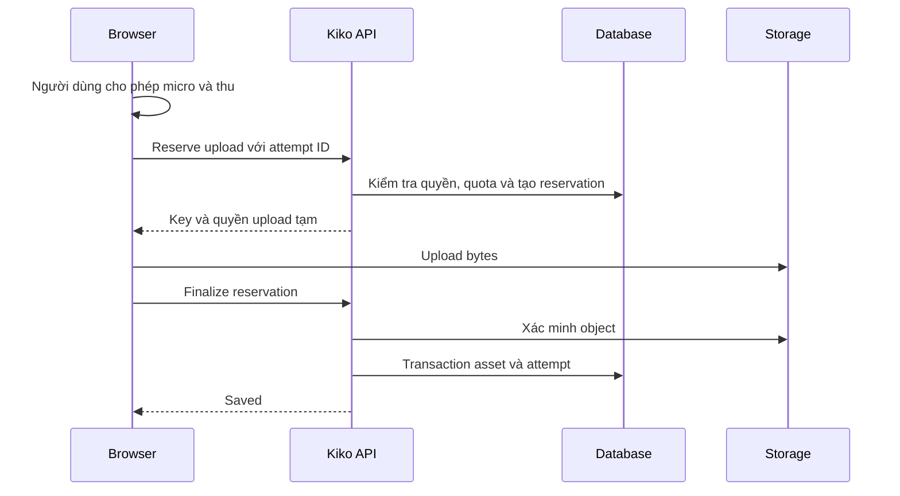

# Kiko — Solution Architecture

**Phiên bản:** 1.0 — Proposed baseline  
**Ngày:** 16/10/2026  
**Góc nhìn:** Solution Architect / Technical Lead  
**Phạm vi:** Web học Trung (`zh`), Nhật (`ja`), Anh (`en`) cho cá nhân, có đường mở rộng nhiều người dùng.  
**Trạng thái:** Thiết kế để review và triển khai theo lát cắt; chưa phải mô tả hệ thống đã chạy.

## 1. Cơ sở và quyền quyết định

Tài liệu dựa trên Project Spec v1.0 và hướng phân quyền được thảo luận sau đó: **RBAC kết hợp quyền sở hữu**. Spec ban đầu gộp Owner/Learner cho một tài khoản; kiến trúc tách hai vai trò và cho tài khoản cá nhân mang cả hai. Cần đồng bộ mục phân quyền của spec trước triển khai, không âm thầm giữ hai quy tắc trái nhau.

Đã xác nhận: tên Kiko, ba ngôn ngữ, nhu cầu từ vựng/đọc/hội thoại/rèn chữ/shadowing. Các lựa chọn stack, nhà cung cấp, giới hạn số liệu và thiết kế chi tiết dưới đây là **khuyến nghị kiến trúc**, chưa được người dùng chốt riêng. Không có xác nhận repo/deployment/database đã tồn tại. Không sử dụng cấu hình của dự án khác cho Kiko.

Tài liệu này mô tả thiết kế mục tiêu, không xác nhận phiên bản, giá hay khả năng cụ thể của dịch vụ bên ngoài. Khi thực hiện, đối chiếu tài liệu chính thức và khóa phiên bản trong lockfile; kiểm chứng bằng spike.

## 2. Mục tiêu, ràng buộc và ngoài phạm vi

### 2.1. Mục tiêu

- Có thể tự phát triển và bảo trì với chi phí kiểm soát được.
- Một nội dung liên kết nghe, đọc, lưu từ, shadowing, luyện chữ và ôn.
- Hỗ trợ cả ba ngôn ngữ ở mô hình dữ liệu và luồng học, không cần ba ứng dụng riêng.
- Dữ liệu học và bản thu riêng tư; không dùng quyền quản trị hệ thống để mặc định đọc dữ liệu người khác.
- Luồng cốt lõi hoạt động khi tắt AI; lỗi tích hợp không làm sập việc học.
- Tính nhất quán, khả năng xuất/khôi phục và lịch sử quan trọng hơn thống kê đẹp.

### 2.2. Phạm vi MVP

Đăng nhập tài khoản được phép; bài văn bản/media trong định dạng hỗ trợ; nhập/sửa phụ đề; chọn/lưu từ; nghe theo câu; thu/nghe đối chiếu; luyện nét zh/ja với dữ liệu được chọn; thẻ ôn; tiến độ; xuất/khôi phục.

Chưa gồm: đồng bộ offline đầy đủ, app native, chấm chữ đẹp/phát âm, hội thoại AI, tự xử lý mọi URL, classroom, thanh toán hoặc chia sẻ công khai. Bộ mẫu của mỗi ngôn ngữ nhỏ và có kiểm tra nội dung.

### 2.3. Driver kiến trúc

| Driver | Hệ quả |
|---|---|
| Nhóm phát triển nhỏ | Một codebase, ít dịch vụ vận hành |
| Tương tác viết/thu âm | Xử lý tại trình duyệt, kiểm chứng thiết bị sớm |
| Media dung lượng lớn | Bytes đi trực tiếp đến object storage có cấp quyền |
| Nội dung riêng tư | Kiểm tra quyền server và phạm vi cache/storage |
| Lịch sử học | Version và snapshot, không sửa lịch sử theo nguồn mới |
| Tích hợp chưa chốt | Adapter; không để provider schema lan vào domain |
| Có thể nhiều người sau này | owner_id và test cách ly ngay từ đầu |

## 3. Quyết định cấu trúc: modular monolith

Khuyến nghị **modular monolith**: một ứng dụng web với module nghiệp vụ độc lập về trách nhiệm, một PostgreSQL, một object storage và worker khi có tác vụ dài. Worker là cùng codebase nhưng có thể chạy tiến trình riêng; không phải yêu cầu xây microservices.

Lý do: giảm số nơi triển khai, dễ transaction và truy vết; vẫn tách được media jobs hoặc AI khi bằng chứng tải/giới hạn runtime yêu cầu. Tránh thêm Redis, vector database hoặc message broker chỉ vì hệ thống có AI trong roadmap.

### 3.1. Stack khuyến nghị

| Thành phần | Đề xuất | Giới hạn/quyết định cần kiểm chứng |
|---|---|---|
| Web | Next.js App Router + TypeScript | Server/client boundary phải rõ; chốt phiên bản trước bootstrap |
| Database | PostgreSQL, có thể dùng Supabase quản lý | Region, backup, pool và quyền truy cập chưa chốt |
| ORM/migration | Prisma cho schema nghiệp vụ — **Accepted** (DEC-005) | SQL RLS/grant/function là migration viết tay trong `prisma/migrations/`; runtime `kiko_app` tách khỏi `postgres` migration (DEC-006) |
| Authentication | Supabase Auth, OTP qua email — **Accepted** (DEC-001) | Admission bằng allowlist do Owner cấp trước; `getClaims()` mỗi request (DEC-002, DEC-007) |
| File | Supabase Storage hoặc object storage tương đương | Private bucket, policy và signed upload/read phải thử |
| UI | Một bộ component và token thống nhất | Chưa chốt thư viện/phong cách; không trộn nhiều UI kits |
| Viết/audio | SVG/Canvas, Pointer Events, browser media APIs | Codec, độ trễ, iOS/Android và bút phải spike |
| Jobs | PostgreSQL-backed job table + worker | Cần runtime thực sự chạy worker; không giả định serverless giữ tiến trình |
| Hosting | Managed web hosting + runtime cho worker nếu cần | Chọn theo ngân sách và giới hạn thực tế |

Chưa chọn phiên bản thư viện hoặc gói dịch vụ. Tắt các chức năng phụ thuộc nhà cung cấp khi cấu hình chưa sẵn sàng.

## 4. Sơ đồ hệ thống và ranh giới tin cậy



Trình duyệt là môi trường không tin cậy đối với identity/role/owner/quota. Upload trực tiếp không cho browser quyền quản trị storage. Server và worker dùng identity khác nhau theo nhiệm vụ. Provider ngoài chỉ nhận dữ liệu cho tác vụ được bật/cho phép. Cache, log và bản backup cũng là nơi chứa dữ liệu cần kiểm soát.

## 5. Module và hướng phụ thuộc

| Module | Sở hữu nghiệp vụ | Phụ thuộc hợp lệ |
|---|---|---|
| identity | Phiên, allowlist, role assignment | Auth adapter, policy |
| language | Ngôn ngữ, script, capability | Không phụ thuộc provider |
| content | Lesson, media linkage, transcript version, segment | identity, language, storage port |
| vocabulary | Từ, nghĩa, cách đọc, deck, occurrence | identity, language, tham chiếu content |
| writing | Ký tự, dataset, lượt viết | language, identity, dataset adapter |
| shadowing | Lượt luyện và audio linkage | content, identity, storage port |
| review | Card, event, lịch ôn | vocabulary, identity, clock |
| progress | Truy vấn tổng hợp | Read models của hoạt động |
| transfer | Export/import, mapping, staging | Các application services có scope |
| jobs | Lease, retry, trạng thái tác vụ | Handler đăng ký rõ ràng |
| integrations | Adapter auth/storage/dictionary/AI | Interface do application định nghĩa |

UI/controller gọi application service; service gọi domain policy và repository/port; adapter triển khai truy cập ngoài. Không gọi provider trực tiếp từ component; không để module sửa bảng module khác tùy ý. MVP có thể dùng service đơn giản, không cần xây framework DI phức tạp.

### 5.1. Cấu trúc thư mục đề xuất

```text
app/                      Routes, layouts, server/client entrypoints
components/               UI dùng chung
modules/
  identity/ language/ content/ vocabulary/
  writing/ shadowing/ review/ progress/ transfer/
server/
  auth/ policy/ db/ storage/ jobs/ integrations/
lib/                      Utility không mang nghiệp vụ tùy tiện
prisma/schema.prisma
prisma/migrations/
db/policies/              SQL versioned nếu tách khỏi Prisma
workers/
tests/
docs/decisions/
AGENTS.md
PROJECT_SPEC.md
ARCHITECTURE.md
```

Đây là cấu trúc đề xuất cho repo mới, không phải cây thư mục đã tồn tại. Với repo có sẵn, ưu tiên cấu trúc hợp lý hiện có. Không có secrets, media cá nhân hoặc dump trong Git.

## 6. Thiết kế frontend

- Shell: chọn ngôn ngữ, thư viện, từ vựng, luyện viết, ôn, tiến độ, cài đặt.
- Learning workspace: player/văn bản, câu, bản dịch/cách đọc, chọn cụm từ, shadowing.
- State server: tài nguyên đã lưu; state client: player position, recording state, stroke buffer và draft.
- URL chỉ chứa ID/filter không nhạy cảm; không chứa secret, audio transcript riêng hoặc signed URL dài hạn.
- Không cần global state store cho mọi trường form; thêm khi có nhu cầu chia sẻ state thật.
- UI có loading/empty/error/unsupported/permission-denied/unsaved states.
- Cache response cá nhân phải theo actor và quyền; không dùng public/static cache cho trang học riêng tư. Với framework version cụ thể, cấu hình cache cần kiểm tra rõ.

### 6.1. Ngôn ngữ

`language_code` khác UI locale, script variant và pronunciation locale. Không auto gộp zh/ja cùng mặt chữ. Hỗ trợ furigana theo span khi có, IPA/pinyin/kana là loại notation riêng. Cho chọn cụm từ thủ công; tokenizer là hỗ trợ sau, không phải nguồn chân lý.

Lưu offset theo một quy ước thống nhất (đề xuất UTF-16 cho MVP), kèm snapshot nguyên văn và kiểm tra range; không dùng offset trên text đã normalize. Xử lý Unicode và grapheme trong UI riêng để tránh cắt sai phần hiển thị.

## 7. Identity và authorization

### 7.1. Mô hình

RBAC quyết định hành động; ownership/resource scope quyết định đối tượng. Tài khoản khởi đầu mang `OWNER` và `LEARNER`.

| Quyền ví dụ | LEARNER | OWNER |
|---|---|---|
| lesson.manage_private, vocabulary.manage_private | Của mình | Chỉ khi có LEARNER |
| recording.manage_private, review.submit, progress.read | Của mình | Chỉ khi có LEARNER |
| data.export_self, data.restore_self | Của mình | Chỉ khi có LEARNER |
| catalog.manage_shared | Không | Có |
| system.configure, integrations.configure | Không | Có |
| access.manage, quota.configure | Không | Có |
| recording.read_other | Không | Không mặc định |

Permission names là đề xuất có thể điều chỉnh nhưng semantics phải giữ. Không cần custom role editor MVP. Role/permission mapping versioned trong code; `UserRole` lưu assignment. Shared catalog là scope rõ ràng do Owner quản lý; dữ liệu người học không tự thành shared khi Owner sửa.

### 7.2. Đường kiểm tra

1. Xác minh phiên bằng cơ chế server được provider khuyến nghị; không tin cookie/token chỉ decode mà chưa verify.
2. Kiểm tra tài khoản được phép và trạng thái hoạt động.
3. Resolve role từ nguồn tin cậy; định nghĩa cache/revocation.
4. Kiểm tra permission.
5. Query theo owner/scope, kiểm tra quan hệ parent/child.
6. Validate input rồi transaction.

Mọi list/download/export/upload/finalize/job cũng áp dụng. Không dựa vào UI ẩn nút. Không cho profile update ghi role hoặc owner. Revoke role/allowlist phải chặn request tiếp theo theo chính sách invalidation đã kiểm thử; không hứa tức thì khi token còn cache mà chưa có cơ chế.

### 7.3. Database và RLS

Đề xuất MVP truy cập nghiệp vụ qua server, chưa mở browser truy vấn database trực tiếp. RLS vẫn bảo vệ các bảng được expose qua data API và storage. Nếu server Prisma dùng role bypass RLS, ownership filter là bắt buộc. Runtime database role không dùng quyền schema owner/superuser nếu có thể tránh; migration dùng credential riêng. Nếu runtime cần bypass do môi trường provider, ghi rõ rủi ro và kiểm tra cách ly ở integration tests.

Tránh nhận identity bằng session setting khi pool tái sử dụng mà không reset; nếu chọn RLS theo context, dùng transaction-local setting và kiểm chứng connection pooling. Shared catalog read/write có policy riêng, không trộn với personal table bằng điều kiện rộng.

## 8. Mô hình dữ liệu logic

| Nhóm | Thực thể | Invariant trọng tâm |
|---|---|---|
| Identity | UserProfile, AllowedAccount, UserRole | Không tự gán role; role cố định ở MVP |
| Language | Language, UserLanguagePreference | zh/ja/en rõ ràng |
| Content | Lesson, MediaAsset, TranscriptVersion, Segment | Version bất biến sau publish |
| Vocabulary | VocabularyItem, Pronunciation, Occurrence, Deck, DeckItem | Cùng owner và ngôn ngữ |
| Writing | Character, StrokeDataset, VocabularyCharacter, WritingAttempt | Dataset gắn language/script/version |
| Shadowing | ShadowingAttempt | Snapshot câu và media context |
| Review | ReviewCard, ReviewEvent | Event chống trùng; optimistic version |
| Activity | StudySession, ActivityEvent khi cần | Không suy ra proficiency |
| Transfer | ExportJob, ImportBatch, ImportMapping | Staging không công bố nửa chừng |
| Operations | ProcessingJob, UploadReservation, AuditEvent | Scoped, bounded, retry được |

Private tables có owner_id. Foreign keys và unique/check/composite constraints cần được chọn ở schema vật lý để chống nối chéo owner; không chỉ dựa vào quy ước code. Catalog chỉ đọc công khai nội bộ được tách khỏi private. Không dùng một JSON blob chứa toàn bộ hồ sơ học.



### 8.1. Constraints và index

- Segment timestamps cùng null hoặc cùng có giá trị; khi có: start >= 0, end > start. CHECK phải NULL-safe, có test âm.
- Lesson active version phải thuộc đúng lesson; occurrence/card/deck relations giữ đúng owner/language.
- Unique `(owner_id, client_event_id)` cho event retry; `(owner_id, operation_type, idempotency_key)` cho thao tác phù hợp.
- Index private list theo `(owner_id, language_code, status, updated_at, id)` theo query thực tế; due cards theo `(owner_id, due_at, id)` với điều kiện active phù hợp.
- Không unique vocabulary theo surface toàn hệ thống; một mặt chữ có thể nhiều nghĩa/ngôn ngữ.
- ReviewCard MVP FK đến vocabulary, có direction; chưa dùng target_type/target_id không có integrity.
- UTC cho timestamp; timezone trong profile. Giới hạn JSON nét, số điểm và payload server-side.
- Index tối thiểu theo explain/đo tải; không tạo mọi tổ hợp bộ lọc.

### 8.2. Version và xóa

Sửa transcript tạo draft version rồi publish atomically đổi active pointer. Attempt giữ snapshot text/time và dataset version; sửa/xóa câu mới không viết lại lịch sử. Không đổi language của lesson đã có dữ liệu phụ thuộc; tạo bản sao có kiểm tra.

Archive giữ history và loại khỏi hàng ôn. Hard delete theo quy tắc domain, không cascade mù quáng qua lịch sử. File chuyển pending_delete và dọn có retry. Xóa metadata không đảm bảo object đã bị xóa; trạng thái vận hành phải thể hiện được.

## 9. Hợp đồng application/API

Khuyến nghị: server functions cho mutation form nội bộ; Route Handlers cho upload finalization, download/export và tích hợp. Cả hai cùng gọi application services; không xây hai đường logic khác nhau. Nếu sau này có native app, expose API versioned từ các service đó.

| Use case | Input cần thiết | Bảo đảm |
|---|---|---|
| createLesson | language, title, request ID | Scoped draft, retry không trùng |
| publishTranscript | lesson, base version, segments | Validate toàn bộ; conflict nếu cũ |
| saveVocabulary | text, meanings/readings, occurrence | Từ và liên kết cùng transaction |
| reserveUpload | purpose, MIME, bytes, attempt ID | Key và quyền tạm scoped |
| finalizeRecording | reservation, attempt ID | Verify object; không tin tùy ý key |
| submitReview | card, base version, event ID, rating | Lịch/history atomic, idempotent |
| createExport | scope, request ID | Artifact riêng tư, có expiry |
| restoreImport | staging ID, request ID | Preview trước; chỉ hồ sơ trống MVP |

Error contract gồm code ổn định, thông điệp an toàn, request_id và field errors khi phù hợp. Không trả SQL/stack/secret. Phân biệt validation, auth, forbidden/not-found theo policy chống lộ existence, conflict, quota và transient failure. Idempotency key scope theo actor/action; cùng key khác payload phải conflict, không tái dùng kết quả sai.

## 10. Các luồng quan trọng

### 10.1. Nội dung và phụ đề

Chọn ngôn ngữ → nhập văn bản/file/SRT/VTT → staging → parse/validate → preview và sửa → publish. Không thời gian thì chỉ đọc; shadowing theo câu cần timestamps hợp lệ. Không tải URL bất kỳ bằng backend; nguồn video phải có adapter allowlist và quyền sử dụng phù hợp.

Đầu vào hạn chế theo bytes, số câu, độ dài text, thời lượng và định dạng. Câu chồng thời gian có cảnh báo và quy tắc player rõ. Tắt HTML thực thi; subtitles/AI output là text không tin cậy.

### 10.2. Thu âm và upload



Không giữ transaction database trong suốt upload mạng. Giữ bản local cho đến Saved; retry cùng ID không nhân bản. Finalize kiểm tra scope/key/type/size thực tế; quota reserve và commit phải race-safe. Object không thể bị thay bằng upload lại sau khi verify: dùng key bất biến/unique, quyền ghi không overwrite và kiểm chứng cơ chế provider; nếu không đảm bảo, chuyển object sang key final server-controlled trước công bố.

State: recording → local_ready → uploading → saved; upload_failed có retry/hủy. Browser format được capability-detect; không ép codec chưa hỗ trợ. Giải phóng tracks/object URLs. Không tự bật micro khi load trang. Nghe rồi nhắc lại và nói đuổi theo là hai mode; dùng tai nghe giảm thu lẫn loa. Không chấm phát âm MVP.

### 10.3. Luyện viết

Language/script → Character → StrokeDataset đã chọn → hiện mẫu → thu stroke points → tự đánh giá → lưu. Render tại client; không gửi từng điểm qua mạng. Normalize tọa độ theo canvas, xử lý pointer cancel/resize và undo. Chỉ khóa touch scrolling trong vùng viết. Thiếu dataset thì viết tự do có nhãn, không báo đúng.

Dữ liệu nét catalog có license/version. Không tái dùng mặc định một dataset chữ Hán cho kanji. Kiểm tra hình dạng/thứ tự nét sau MVP cần đánh giá dung sai; không tương đương chấm chữ đẹp.

### 10.4. Ôn tập và cạnh tranh cập nhật

Client gửi event_id + card_version + rating. Server kiểm tra event đã có trước; retry trả kết quả cũ. Nếu chưa có, transaction lock hoặc update có điều kiện version, tạo event và cập nhật due_at; stale version trả conflict. Unique constraint xử lý race duplicate, không chỉ kiểm tra trước ở code. Dùng clock server cho reviewed_at.

Lịch v1 trong spec là đề xuất cần chốt trước code; lưu algorithm_version và test đầu/cuối bậc, Quên/Khó/Nhớ, timezone. Không thay thuật toán bằng một thư viện mới mà không ghi decision.

### 10.5. Export/restore

Export xác định snapshot/cutoff nhất quán, manifest schema_version, danh sách ID/file và checksum. Gói chỉ dữ liệu được phép; bytes bản thu thực, không signed URL. Catalog có thể reference-only theo license. Artifact riêng tư có thời hạn và cleanup.

Import ZIP: kiểm tra compressed/uncompressed size, số file, đường dẫn/symlink và schema; parse staging; kiểm tra referential integrity; preview; owner luôn từ session; remap ID. MVP chỉ restore hồ sơ trống. Dữ liệu staged chưa thấy trong query học; commit visibility bằng batch trạng thái hoặc transaction phù hợp. File transfer ngoài transaction dùng staging/cleanup, không hứa atomic bytes+DB. Retry theo import_id; failure không báo thành công một phần.

## 11. Jobs và xử lý nền

PostgreSQL queue đủ cho tải cá nhân dự kiến nhưng cần đo. Worker nhận job bằng transaction claim/lock phù hợp và lease; heartbeat cho job dài. State queued/running/succeeded/failed/cancelled. Attempt cap, backoff, timeout và terminal error bắt buộc. Chạy ít nhất một lần là giả định thiết kế; handler phải idempotent, không tuyên bố exactly-once với API bên ngoài.

Khi mutation bắt buộc tạo job, ghi job trong cùng DB transaction (transactional outbox/job table). Worker chỉ đọc owner/resource/config cần thiết; không nhận SQL/command tùy ý từ payload. Dịch vụ AI có request ID của provider thì lưu phục hồi; không retry mù gây thanh toán trùng. Chọn runtime worker trước khi bật tính năng phụ thuộc; cron chỉ là phương án được đánh giá, không giả định có sẵn.

## 12. AI và dữ liệu ngoài

Interface theo use case: dictionary lookup, stroke lookup, transcription, pronunciation assessment, conversational practice. Provider adapters tách khỏi domain; output normalize/validate và có source/version. API secret chỉ server.

AI mặc định tắt. Trước bật: biết data gửi đi, provider/retention, ngôn ngữ hỗ trợ, chi phí, cap và cách hủy. Không dùng ASR text match làm điểm phát âm. Đánh giá từng ngôn ngữ và biến thể trước công bố khả năng chấm; điểm các provider không so sánh trực tiếp.

Không cần RAG/vector database cho MVP. Lesson text và AI output không được điều khiển tools, role hoặc chạy code/SQL. Model không phải ranh giới authorization. Chức năng học vẫn hoạt động khi provider lỗi hoặc đạt cap.

## 13. Bảo mật và threat model rút gọn

| Mối đe dọa | Kiểm soát thiết kế | Kiểm chứng |
|---|---|---|
| Đọc dữ liệu chéo bằng ID | Permission + owner filter, parent-child invariant | Hai learner giả lập, đổi ID ở mọi endpoint |
| Tự nâng role | Role server-side, profile field allowlist | Mass-assignment và stale-session tests |
| XSS qua subtitle/import | Text rendering, sanitize rich content | Payload script/HTML, không thực thi |
| CSRF/session misuse | Cơ chế auth chuẩn, cookie/CSRF/origin controls phù hợp | Request cross-origin, session hết hạn |
| SSRF qua URL media | Adapter allowlist, kiểm tra DNS/IP/redirect/port | Private/link-local/metadata, redirect tests |
| Lạm dụng upload | Type/size/quota, key server, finalize | Spoof MIME, race quota, key người khác |
| ZIP traversal/bomb | Safe extraction, hard limits | Path/symlink/decompression tests |
| Lộ secret qua bundle/log | Server-only modules, redact, secret scan | Bundle/config diff và log samples |
| Cache lộ dữ liệu | Private/no-store theo resource, key actor | Logout/đổi user và cache tests |
| AI prompt injection | Data/tool isolation, schema và policy ngoài model | Lesson chứa chỉ dẫn giả |

Không tắt RLS, TLS verification hay security headers để chữa lỗi. Exact auth redirects và chính sách CORS; CORS không thay auth. Prepared queries, không nối chuỗi SQL/shell. Rate limit thao tác đắt. Không xuất audio/text cá nhân vào log hoặc fixture mặc định. Audit role/config/export/restore bằng metadata tối thiểu, không chứa secrets.

## 14. Môi trường và CI/CD

- Local: database/storage/auth cô lập, dữ liệu synthetic; env placeholders.
- Test/preview: không trỏ DB production; không dùng credentials production cho PR không tin cậy.
- Production: secret store, region thống nhất khi phù hợp, private storage và restricted access.

CI đề xuất: install bằng lockfile → lint → typecheck → unit/integration trên DB disposable → build → secret/dependency checks phù hợp. Không chạy migration production tự động từ PR. Preview chỉ deploy theo pipeline và audience đã xác định, không công khai dữ liệu mẫu riêng tư.

Migration review: exact SQL, impact, khóa/backfill, backup và restore plan; không reset/schema push trên DB shared. Expand-contract cho thay đổi khó tương thích. Prisma sở hữu bảng nghiệp vụ; RLS/storage/auth SQL có version và thứ tự apply rõ. Migration credential tách runtime. Deploy/merge/migration thực hiện theo phạm vi được người dùng cho phép, không mặc định được phép vì code đã xong.

## 15. Quan sát, vận hành và khôi phục

### 15.1. Theo dõi

Structured logs: request_id, operation, duration, status/error_code. Metric: API latency/errors, DB pool saturation, upload fail/finalize lag, orphan files, queue age/retry, storage bytes, AI usage/cost khi bật. Không log token/signed URL/audio/transcript. Audit dùng access policy riêng và retention hữu hạn.

### 15.2. Mục tiêu đề xuất cần đo

| Chỉ tiêu | Baseline đề xuất | Ghi chú |
|---|---|---|
| API metadata nhỏ p95 | < 1 giây | Trên bộ mẫu và môi trường ghi rõ; không gồm upload/AI |
| Lặp câu local audio | Sai số mục tiêu < 250 ms | Chỉ thiết bị đã spike, nguồn nhúng có thể khác |
| RPO backup | <= 24 giờ | Cần lựa chọn gói/cơ chế thực sự đáp ứng |
| RTO cá nhân | <= 1 ngày | Phải diễn tập, chưa phải SLA |

Không cam kết số liệu này đã đạt. Kết quả spike có thể yêu cầu điều chỉnh và review.

### 15.3. Backup và sự cố

Backup database và object storage có lịch, retention và access riêng; schema backup không thay backup media. Định kỳ restore vào môi trường cô lập và đối chiếu manifest/liên kết. File export của người dùng là khả năng bổ sung, không thay backup vận hành.

Runbook tối thiểu: DB không kết nối, storage đầy, upload pending lâu, worker hết lease, restore lỗi và credential lộ. Khi lộ secret, ngăn disclosure tiếp, revoke/rotate qua flow được phép; xóa file Git không xóa lịch sử. Duy trì học read-only khi phù hợp; không báo saved giả để che lỗi.

## 16. Quy mô và đường mở rộng

Không chọn số người dùng giả định làm bằng chứng cần microservices. Đo trước: query chậm → index/pagination; file lớn → direct upload/resumable được kiểm chứng; jobs tồn → worker capacity; DB contention → query/transaction tuning; nhiều client → API contract versioned.

Tách service khi có nhu cầu deploy/scale/security boundary độc lập được chứng minh. Chuyển queue khi PostgreSQL queue tạo tải/operability không chấp nhận được. Vector search chỉ thêm khi có use case retrieval và đánh giá kết quả. Multi-user cần account lifecycle, quota, sharing/consent và deletion spec trước mở truy cập rộng.

## 17. Kế hoạch kiểm chứng và triển khai

| Bước | Đầu ra | Gate |
|---|---|---|
| A0 | Spike player/micro/codec/pointer và audit dataset license | Chốt thiết bị, formats, limits; không cần dữ liệu thật |
| A1 | Auth, roles, owner scope, ba ngôn ngữ, lesson text và vocabulary | Cross-owner tests đạt; dữ liệu lưu lại được |
| A2 | Media/subtitle/shadowing/upload pipeline | Retry/partial failure và một bài mỗi ngôn ngữ |
| A3 | Writing zh/ja, review/version và progress | Missing dataset, concurrency, timezone tests |
| A4 | Export/restore, cleanup, observability, hardening | Round-trip có file và checklist MVP |
| A5 | Dùng cá nhân 2 tuần | Sửa bất tiện; quyết định mở rộng |

Mỗi bước cập nhật test evidence và decision records. Không viết hết feature AI trước khi luồng cơ bản ổn định.

## 18. ADR và quyết định còn mở

| ID | Khuyến nghị | Trạng thái / điều kiện |
|---|---|---|
| ADR-001 | Modular monolith | Proposed; phù hợp quy mô cá nhân |
| ADR-002 | Web responsive trước | Proposed; kiểm chứng thiết bị A0 |
| ADR-003 | PostgreSQL + object storage | Proposed; provider/gói chưa chốt |
| ADR-004 | RBAC + ownership, OWNER/LEARNER | Hướng thiết kế từ trao đổi; cập nhật spec trước implementation |
| ADR-005 | Server-first business data access | Proposed; cần kiểm chứng auth/pool/RLS |
| ADR-006 | Transcript version + immutable attempt snapshots | Proposed; nền tảng giữ history |
| ADR-007 | Direct upload + finalize + cleanup | Proposed; provider semantics cần spike |
| ADR-008 | AI optional, no vector DB MVP | Proposed; giữ core độc lập |
| ADR-009 | PostgreSQL job table | Proposed; chỉ bật khi có runtime worker |
| ADR-010 | Empty-profile restore MVP | Proposed; tránh merge không xác định |
| ADR-011 | Auth/admission/DB identity cho lát cắt 1 | Accepted/Derived; chi tiết DEC-001…DEC-013 trong `DECISIONS.md` |

Chốt trước bootstrap: stack/version/package manager, auth method, hosting và DB ownership. Chốt trước media: thiết bị, codec, size/duration/quota, source adapters. Chốt trước writing: script variants, dataset license/coverage. Chốt trước AI: provider, retention, cost và tiêu chí chất lượng. Giọng Anh, mục tiêu HSK/JLPT/CEFR và visual identity không được AI tự suy ra.

## 19. Checklist review kiến trúc

- [ ] Spec và permission matrix không mâu thuẫn.
- [ ] Source of truth migration và runtime identity rõ.
- [ ] Hai user synthetic không truy cập chéo qua API, storage, export hoặc job.
- [ ] Thu/viết được kiểm chứng trên thiết bị mục tiêu.
- [ ] Upload/DB partial failures có retry và cleanup.
- [ ] Review concurrency/idempotency có test thực.
- [ ] Private cache, secrets, logs và backups được kiểm tra.
- [ ] Restore gồm metadata và file đã diễn tập.
- [ ] Cost limits và provider capabilities có evidence trước bật tích hợp.
- [ ] Các quyết định Proposed được review trước khi tạo phụ thuộc khó đảo ngược.

## 20. Tài liệu liên quan và giới hạn

Đọc cùng `PROJECT_SPEC.md`, `AGENTS.md`; sau review tách `ACCESS_CONTROL.md`, schema vật lý, ADR và implementation plan khi cần. Không giả định các file đó đã tồn tại. Hai sản phẩm tham khảo trong brief chỉ cung cấp hướng trải nghiệm; kiến trúc này là thiết kế riêng đề xuất cho Kiko, không phải mô tả kiến trúc của chúng.

| Phiên bản | Ngày | Thay đổi |
|---|---|---|
| 1.0 Proposed | 16/10/2026 | Thiết kế Kiko cho ba ngôn ngữ, modular monolith, RBAC/ownership, media/storage consistency, deployment và vận hành |
