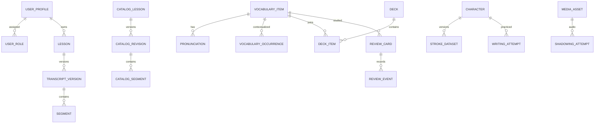

# Kiko — Data Model

**Version:** 1.0 — Proposed logical/relational baseline  
**Updated:** 2026-10-16  
**Target:** PostgreSQL; ORM/migration tooling and exact SQL reviewed before implementation.  
**Status:** Design, not an applied schema. No production migration is authorized by this file.

## 1. Alignment and modeling decisions

Read PROJECT_SPEC.md, ARCHITECTURE.md, ACCESS_CONTROL.md and IMPLEMENTATION_PLAN.md. RBAC has OWNER/LEARNER; own learning data is distinct from catalog data. Initial account has both. This file resolves table-level proposals, not final provider-specific auth/storage SQL.

Key choices proposed here:

- Private and shared catalog content have separate aggregates/tables, avoiding an ambiguous nullable owner or broad scope OR policy.
- Content source references use explicit nullable foreign keys with exactly-one constraints where appropriate, not an unconstrained type/id pair.
- Published transcript/catalog versions immutable; attempts preserve snapshots.
- UTC instants; learner timezone for display/day grouping. UUID identifiers are proposed, not access controls.
- Business table schema managed by one migration owner; auth provider schema remains provider-owned. Exact provider user mapping and privileges are open.

## 2. Types and conventions

| Type | Meaning |
|---|---|
| id | UUID primary key proposed |
| owner_id | FK to Kiko user_profile.id; immutable in ordinary CRUD |
| language_code | FK language.code: zh, ja, en |
| timestamp | timestamptz UTC |
| version | Positive integer optimistic concurrency counter |
| storage_key | Stable private object reference, never a signed URL |
| snapshot | Original text/context at event time, bounded payload |

Common mutable fields: created_at, updated_at, version. Audit/history rows are append-only through application APIs; do not blindly attach mutable updated_at semantics. Store file bytes outside DB. JSONB for bounded structured annotations/strokes/snapshots, not a replacement for core relationships. Limits must be selected during P0 and enforced server-side; no unbounded JSON/text arrays.

Use codepoint_sequence text for a displayed character identity where necessary; do not assume one visible glyph is one byte or one UTF-16 code unit. Selection offsets use UTF-16 on exact source_text_snapshot in MVP; validate bounds and substring server-side. Preserve original text; any normalized search key is separate.

## 3. Identity, account admission and roles

| Table | Important fields | Constraints |
|---|---|---|
| user_profile | id, auth_provider, auth_subject, display_name, timezone, interface_language, state, authorization_revision, timestamps | Unique provider+subject; state pending/active/suspended/removed; revision >=1 |
| allowed_account | id, provider, subject or verified admission selector, status, admitted_by, timestamps | Exact admission binding reviewed for chosen provider; not first-visitor Owner |
| role | code | OWNER, LEARNER only MVP |
| user_role | user_id, role_code, assigned_by, assigned_at | PK user+role; FK both |
| user_language_preference | user_id, language_code, preferred_script nullable, pronunciation_locale nullable, enabled | PK user+language; preferences not permission claims |
| language | code, display_name, capability configuration | Seed zh/ja/en; capability validated in app |

Role-permission mapping lives in versioned code MVP; no editable permission tables required. If duplicated in DB for policies, generate/version from one registry and test parity. auth_subject is not a secret credential but should not be unnecessarily exposed. Do not store access/refresh tokens or passwords here.

User state/role changes increment authorization_revision in the same transaction. Last-active-Owner protection requires serialization/locking across candidate Owner changes; row checks alone cannot guarantee this global invariant. No imported archive may change these tables. Account removal is distinct from deletion of learning data and backup retention.

## 4. Private lessons and transcripts

| Table | Important fields | Constraints |
|---|---|---|
| lesson | id, owner_id, language_code, title, status, source metadata, active_transcript_id nullable, version, timestamps | status draft/ready/archived; unique (id,owner_id,language_code) for composite references |
| transcript_version | id, owner_id, lesson_id, language_code, version_no, state, created_at, published_at nullable | Unique lesson+version_no; composite FK to lesson scope |
| segment | id, owner_id, transcript_version_id, language_code, position, text, translation nullable, speaker nullable, start_ms/end_ms nullable, reading_annotations JSONB nullable | Unique transcript+position; composite FK to version scope |
| lesson_media | lesson_id, owner_id, media_asset_id, position | Same owner; primary track policy MVP one selected track |

Draft transcript rows may be edited; published versions cannot be updated through normal APIs. Publish validates and atomically updates lesson.active_transcript_id. Active pointer references the same lesson/owner/language; enforce through suitable composite FK or equivalent verified constraint structure. Cyclic insertion is handled by creating lesson with null pointer then version, then pointer update in one use-case transaction.

Time constraint must explicitly allow both null or require both nonnull with start>=0 and end>start. Example intent: `(start IS NULL AND end IS NULL) OR (start IS NOT NULL AND end IS NOT NULL AND start>=0 AND end>start)`. Test partial-null and negative cases. Duration upper bounds depend on linked asset and require application validation/appropriate trigger, not a CHECK that queries another table. Overlap is a warning per spec, not automatic rejection. Language is immutable once dependent data exists.

## 5. Shared catalog — separate from private content

| Table | Important fields | Constraints |
|---|---|---|
| catalog_lesson | id, language_code, title, lifecycle, active_revision_id nullable, created_by, timestamps | draft/published/retired; no learner owner semantics |
| catalog_revision | id, catalog_lesson_id, language_code, revision_no, state, source/license metadata, published_at | Unique catalog lesson+revision; published immutable |
| catalog_segment | id, catalog_revision_id, language_code, position, text, translation, speaker, optional times, annotations | FK revision scope; same timestamp validation |
| catalog_media_link | revision_id, media_asset_id, position | Asset catalog scope; validated provenance |

Learners read published revisions; Owner manages drafts. Catalog created_by is audit attribution, not private ownership. Publishing from private content creates a distinct catalog draft with explicit selected fields and rights; never copies attempts, recordings, private notes, review history, or owner account metadata. Copying a catalog lesson into a private lesson creates new IDs and records provenance; it does not grant edits to catalog originals.

## 6. Media, upload reservations and private files

| Table | Important fields | Constraints |
|---|---|---|
| media_asset | id, owner_id nullable, scope, source_type, storage_key nullable, external_ref nullable, detected_mime, size_bytes, duration_ms nullable, checksum nullable, status, version, timestamps | scope private/catalog; private requires owner; catalog requires owner null; exactly one storage/external reference for applicable type |
| upload_reservation | id, owner_id, purpose, staged_key, expected_mime, expected_size, reserved_bytes, state, expires_at, request_key, finalized_asset_id nullable | owner+request key unique; positive bounded sizes; staged key unique |
| media_deletion_job link | asset_id, job_id or deletion status fields | Retry references exact object/version |

Media status: pending/uploaded/ready/failed/pending_delete/deleted. Catalog asset provisioning uses a separate Owner-authorized handler; a learner reservation cannot claim scope=catalog. Parent-child linking checks asset scope and owner. Prefer composite private FK `(asset_id, owner_id)` with private-only link checks; catalog relations validate catalog scope. Exact enforcement may use separate link tables/triggers; it must not rely on nullable FK accidentally bypassing constraints.

Storage is not transactional with DB. Reserve quota atomically, upload to non-overwritable key, verify actual object/type/size, finalize asset+attempt metadata transactionally, release reservation. Retry and cleanup handle stranded files. Verify-then-overwrite must be impossible under selected storage capability; use immutable final key/copy if needed. Do not persist grants/signed URLs. External references only supported adapters, not arbitrary server fetch URLs.

## 7. Vocabulary, decks and source contexts

| Table | Important fields | Constraints |
|---|---|---|
| vocabulary_item | id, owner_id, language_code, surface, meaning, notes nullable, archived_at, version, timestamps | Nonblank surface/meaning according to input policy; no global unique surface |
| pronunciation | id, owner_id, vocabulary_id, language_code, notation_type, value, locale nullable, source metadata | Composite FK word scope; notation pinyin/kana/ipa compatible with language |
| deck | id, owner_id, language_code, title, archived_at, version | Scoped title need not be globally unique |
| deck_item | owner_id, deck_id, vocabulary_id, language_code, added_at | Unique deck+word; scoped FK both sides |
| vocabulary_occurrence | id, owner_id, vocabulary_id, language_code, private_segment_id nullable, catalog_segment_id nullable, manual_source bool, source_text_snapshot, selected_text_snapshot, offset_start/end nullable, source metadata | Exactly one private/catalog/manual origin; same owner on private source, matching language |

Manual source means no segment FK, not unrestricted owner bypass. Use exactly-one checks with explicit nonnull counting (e.g. num_nonnulls over FK fields plus explicit manual discriminator logic). Avoid CHECK expressions that pass UNKNOWN. Offsets either both absent or both valid on snapshot and selected surface; cross-table/source validity enforced in service plus database where practical. Multiple meanings/readings and same surface are allowed; duplicate warning in UI is advisory.

Deleting deck membership does not delete word/card/history. Archive word pauses its active review cards. Hard delete must follow dependency policy; never cascade events away silently. Occurrences can preserve snapshot after source retirement/deletion by retaining tombstone or nullable FK cleared through controlled procedure, while exactly-one origin intent is retained by source_kind + original source metadata. Choose this deletion representation before SQL: either retain source tombstones (preferred MVP) or use a dedicated detached-snapshot origin. Do not implement SET NULL that violates source constraints.

## 8. Character and handwriting

| Table | Important fields | Constraints |
|---|---|---|
| character | id, language_code, codepoint_sequence, script_variant | Unique language+sequence+normalized variant key; null uniqueness handled explicitly |
| stroke_dataset | id, character_id, provider, dataset_version, license_ref, data_ref/checksum, availability, provenance | Unique character+provider+version; immutable versions |
| vocabulary_character | owner_id, vocabulary_id, language_code, character_id, position | Same language, FK word scope; repeated character allowed at different positions |
| writing_attempt | id, owner_id, language_code, character_id, stroke_dataset_id nullable, mode, strokes JSONB, self_rating nullable, created_at | zh/ja only for guided handwriting; selected dataset must belong to character |

Strokes are bounded arrays of strokes/points with normalized x/y and relative time. Validate structure, ranges, nondecreasing times and count/byte limits. Self-rating distinct from algorithm assessment fields; no AI/geometry score in MVP. Missing dataset supports free mode; guided/trace requires a valid matching version. Dataset references retained for historical interpretation; catalog license determines whether export includes data or references only.

## 9. Shadowing attempts

`shadowing_attempt`: id, owner_id, language_code, private_segment_id nullable, catalog_segment_id nullable, source snapshot (text, translation optional, start/end, media context, source revision), mode, audio_asset_id, created_at, deleted_at nullable.

At creation exactly one private or catalog segment; private owner and language must match, catalog must be readable published revision. Retain source tombstones/history rather than dropping the exact-one invariant accidentally on source deletion. Source snapshot immutable; asset is ready/private and same owner before attempt becomes visible as saved.

Client recording state is not necessarily a DB row: recording/local_ready/uploading/upload_failed can remain local/reservation states. Persist ready attempt only upon finalized media, or use an explicit attempt status with queries excluding pending. Pick one approach consistently; recommended MVP is finalized attempt plus upload reservation for pending work. Retry by owner+attempt request ID. Audio bytes not JSON/base64 in the attempt table.

## 10. Review engine

| Table | Important fields | Constraints |
|---|---|---|
| review_card | id, owner_id, vocabulary_id, language_code, direction, state, due_at, step, algorithm_version, version, timestamps | FK word scope; unique active word+direction per owner; state active/paused/archived |
| review_event | id, owner_id, card_id, client_event_id, request_hash, rating, reviewed_at, previous_card_version, resulting_version, previous schedule snapshot, next schedule snapshot | Unique owner+client_event_id; append-only; rating forgotten/hard/remembered |

MVP card target is vocabulary FK, not target_type/target_id. Other card types require migration with real FK invariants. Schedule v1 remains proposed in spec until reviewed; keep configuration/version and test boundary behavior.

Submission transaction: detect existing client event and compare payload hash; same request returns stored result; mismatched key/payload conflicts. Otherwise conditional card update/row lock validates base version, updates schedule and inserts event atomically. Unique event constraint handles concurrent retries. Concurrent different event on stale version conflicts rather than overwriting. Use server clock; represent instants UTC and day groups by profile timezone. Preserve card tombstones/history when words archived/deleted per explicit retention policy.

## 11. Activity and progress

`study_session`: id, owner_id, language_code, started_at, ended_at nullable, explicit completion metadata where appropriate. Optional `activity_event`: id, owner_id, language_code, session_id nullable, activity_kind, resource context, occurred_at, idempotency key.

Do not duplicate every review/attempt as another event unless needed; progress can aggregate authoritative review_event, writing_attempt and shadowing_attempt. Distinguish unique resources from attempts. Do not count open-tab duration as study time; active-time metrics require an approved measurement rule. No proficiency or HSK/JLPT/CEFR score inferred from counts.

## 12. Jobs, transfers, quota and audit

| Table | Important fields | Constraints |
|---|---|---|
| processing_job | id, owner_id nullable, scope, type, payload schema/version, idempotency_key, request_hash, state, attempt_count, lease_until, next_run_at, error_code, timestamps | Explicit personal/system scope, bounded retries, unique scoped key |
| import_batch | id, owner_id, import_id, schema_version, state, staged_manifest, validation_summary, created_at | Unique owner+import_id; staged data hidden until publish |
| import_mapping | batch_id, entity_type, old_id, new_id | Unique batch+entity type+old ID; type allowlist |
| export_artifact | id, owner_id, job_id, schema_version, snapshot cutoff, asset reference, manifest checksum, expires_at, state | Private artifact, expiry, scoped download |
| usage_account | owner_id, committed_bytes, reserved_bytes, version | Nonnegative; atomic reservation/finalization/release |
| quota_policy | scope/account selector, limits, revision, changed_by | Owner-controlled, validated limits |
| audit_event | id, actor_id nullable, operation, target class/id minimized, result, authorization_revision, request_id, occurred_at | Append-only through app; retention/access defined |
| source_license | id, provider, source_ref, license identifier/text ref, attribution, version, export policy | No assumption of redistribution rights |

Job payload references IDs and allowed handler input, never executable SQL/shell or arbitrary identity claims. Recheck actor state and resource permissions at execution and before sensitive writeback. System jobs need explicit bounded scope, not owner=null means unrestricted. Use at-least-once processing with idempotent handlers, lease/heartbeat and backoff.

Transfer imports only learning data; never user_role, account state, secret configuration or authorization_revision. ZIP/file validation happens before database publication. Staging/final visibility and cleanup account for nontransactional object storage. Quota counters need reconciliation against real assets/reservations, not just increment/decrement happy paths.

## 13. Logical relationships

Diagram omits ownership FKs and exclusive source relations for readability; tables and invariants above remain required. It is not a migration-ready schema.

## 14. Index and query strategy

- Private lists start with owner_id, then common language/state/order columns; keyset pagination where stable ordering matters.
- Due cards: owner_id + due_at + id for active cards, scoped to live vocabulary.
- Segments: transcript_version_id + position unique; catalog equivalent.
- Attempts: owner_id + language_code + created_at + id for history; asset/source FK indexes where queried.
- Jobs: state + next_run_at + lease_until according to claim strategy; scoped idempotency uniqueness.
- Upload cleanup: state + expires_at; assets pending_delete/status queries.
- Search initially scoped simple queries; introduce specialized text/search indexes only with relevance and language evaluation. English stemming is not a solution for zh/ja.

Use EXPLAIN and realistic synthetic dataset before adding many indexes. No global scans returned to browser for owner filtering. Private joins/counts/progress must filter before aggregate/pagination.

## 15. Access enforcement

Central application permissions plus scoped repositories; RLS/grants for exposed data/storage paths. Owner role has no private row bypass. Composite scope constraints protect integrity, not a substitute for caller authorization. Roles from provider JWT require verified mapping; profile fields are not role authority.

Separate runtime/migration credentials. If Prisma runtime bypasses RLS, service ownership checks and direct exposure restrictions must be tested. Do not add SECURITY DEFINER helpers without explicit grants, fixed search path/object qualification and authorization. Pooled per-request context must use safe transaction-local scope, not leaked session settings.

Secrets live outside these business tables. Logs/audit omit raw lessons, audio, credentials and signed URLs. Private cache/export/backup requires separate access policy. Data minimization applies even though MVP initially has one person.

## 16. Deletion and retention policy matrix

| Object | Default ordinary action | History/file behavior |
|---|---|---|
| Lesson/word/deck | Archive | Preserve snapshots/events; hide active queues |
| Published transcript/catalog revision | Immutable, retire/version | Keep referenced source/tombstone |
| Deck membership | Delete link | Word/cards unchanged |
| Recording | Pending-delete then object cleanup | Do not delete source lesson; stop new signed URLs |
| Writing attempt | Self-delete per policy | No implicit deletion of catalog dataset |
| Review event | No generic edit/delete | Account data erasure procedure separately defined |
| Upload staging | Expire/cleanup | Release quota and remove stranded objects |
| Export artifact | Expire/cleanup | Own data in database unchanged |
| Account | Suspend/remove access first | Permanent erasure/backup expiry requires separate procedure |

Exact retention durations remain open. Hard delete must reconcile FK constraints and chosen source tombstones; do not use contradictory SET NULL/CASCADE defaults. Backup copies may persist until configured expiry; never promise instant global deletion. Test cleanup retries and partial failures.

## 17. Migration sequence and verification

Suggested dependency order, to align with implementation tasks:

1. Identity/language/roles and account invariants (006–007).
2. Private lesson/transcript/vocabulary/deck scope (008–009).
3. Catalog/provenance and scope rules (010).
4. Media/reservation/attempt links/versioned segments (011–014).
5. Character/dataset/writing and review engine (015–016).
6. Progress queries and transfer/jobs/quota/audit (017–021); add required upload/job/quota pieces earlier when first used.

Incremental migrations follow feature needs; do not create all tables before validating first slice. Applied migrations are append-only in shared environments; corrective changes use new migration. Test rollback/recovery limitations; DB schema rollback is not automatically data restore.

Before any shared/production execution: review exact SQL, environment, data impact, locks/backfill, backup and authorization. Local disposable migration tests include constraints, RLS/runtime identities, cross-owner inserts, partial-null times, role race, duplicate/stale review, upload quota race, export/restore referential integrity and Unicode offsets.

## 18. Open physical-schema decisions

Auth provider mapping/admission selector; nullable variant uniqueness approach for selected PostgreSQL version; exact tables/schema names; trigger vs composite FK for scope links; data-size constraints; dataset payload storage; source tombstone retention; quota reconciliation job; export snapshot strategy; privileged runtime policy; migration ownership split with provider auth/storage schemas.

These must be resolved in ADR/schema review before SQL generation. This document is intentionally detailed enough for modeling, but should not be pasted into a migration tool as executable SQL. Keep docs and schema synchronized as decisions become Accepted.

| Version | Date | Change |
|---|---|---|
| 1.0 Proposed | 2026-10-16 | Initial relational model and integrity rules for Kiko, separate private/catalog aggregates and historical snapshots |

---

## Research-informed data model candidates (2026-10-19)

These are design-review candidates only; **do not generate or deploy migrations from this section**.

- Preserve source context on each vocabulary occurrence: lesson/version/segment, immutable text snapshot, optional time range, source rights metadata and language. Keep cross-owner and cross-language integrity constraints.
- Separate capture from recall evidence: a saved item, a practice attempt, a due review and a demonstrated retrieval are not interchangeable. Existing ReviewEvent can be evaluated for response mode, prompt type, result, scheduler version and timestamp without inferring proficiency.
- Consider optional onboarding preferences: learning goal, chosen language, self-reported level, preferred session duration and guided/content-first mode. Collect minimally, allow editing and avoid sensitive profiling by default.
- Model language capabilities explicitly (script, pronunciation notation, handwriting/stroke dataset availability, tone support), not as a global boolean. Only add language codes after content/UX validation.
- For AI, separate user input, generated feedback, provider transmission consent, retention/deletion and correction status. Do not store raw voice or transcripts by default without a documented need and consent.
- Keep per-user isolation, export/delete consistency and immutable historical snapshots. Schema changes require ADR, migration review, backward compatibility and security tests.

See `RESEARCH_INSIGHTS.md`.
