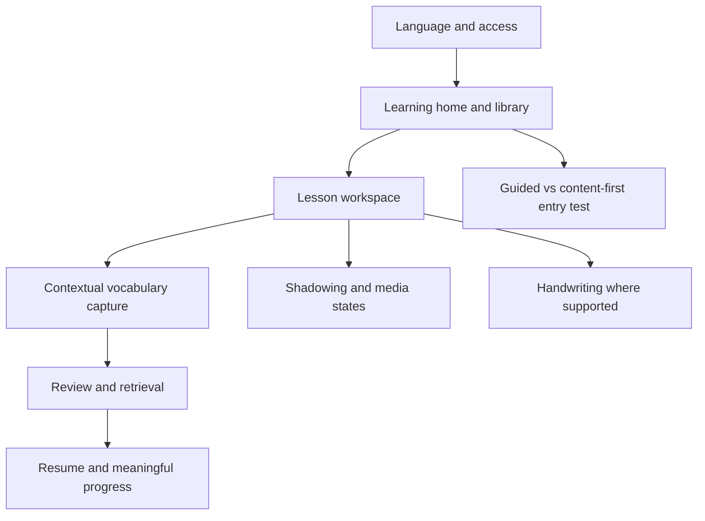

# Kiko — Feature Prioritization for UX/UI

**Version:** 0.1 | **Date:** 2026-10-19 | **Status:** Proposed UX design priorities; not an approved product scope change
**Market:** Vietnamese-speaking language learners
**Inputs:** USER_RESEARCH_SYNTHESIS.md, PERSONAS_AND_JTBD.md, PRD.md, PROJECT_SPEC.md, UI_SPEC.md

## 1. Purpose and decision rules

Determine **what to design first**, not what to implement immediately. Distinguish the existing technical MVP baseline from new research-informed prototypes and deferred concepts.

Priority considers: (1) central learner job; (2) dependency for an end-to-end journey; (3) evidence strength and uncertainty; (4) design/testing effort; (5) security and language feasibility. These are qualitative judgments, **not numerical market-demand scores**.

Labels:
- **Baseline:** already specified in current PROJECT_SPEC.md; retain scope, verify implementation status separately.
- **P0 UX:** necessary to prototype the first complete learning journey.
- **P1 UX:** important supporting journey or behavior, after P0 flow is coherent.
- **Experiment:** unvalidated alternative; test before adopting.
- **Deferred:** do not design as committed MVP functionality.
- **Research only:** needs discovery before solution design.

## 2. Prioritization matrix

| ID | Feature / experience | User job | Existing status | UX priority | Design decision |
|---|---|---|---|---|---|
| F01 | Sign in, access-denied, account/session states | All | Baseline | P0 UX | Design core access states, no implied public signup |
| F02 | Select learning language and per-language state | J01/J08 | Baseline zh/ja/en | P0 UX | Visible language context, supported features only |
| F03 | Lesson library: choose, create, resume | J01/J02/J05 | Baseline | P0 UX | Clear empty state and first action |
| F04 | Lesson workspace: text, audio and sentence context | J02 | Baseline | P0 UX | Read/listen first; avoid overloaded controls |
| F05 | Select phrase, save vocabulary with source | J03 | Baseline; context enhancement proposed | P0 UX | Design selection, save, duplicate and source return |
| F06 | Vocabulary detail and deck | J03 | Baseline | P0 UX | Show source, reading, meaning and edit/archive |
| F07 | Retrieval review: prompt, reveal, self-rating, due queue | J04 | Baseline; UX refinements proposed | P0 UX | Do not confuse activity with recall |
| F08 | Learning home: next action, resume, due review | J01/J05 | Baseline shell; UX hypothesis | P0 UX | Prioritize one meaningful next action |
| F09 | Shadowing: listen, repeat, record and replay | J06 | Baseline | P1 UX | Clear permission and saved/unsaved states |
| F10 | Handwriting zh/ja and unsupported fallback | J08 | Baseline | P1 UX | Touch/pen, dataset missing, no false scoring |
| F11 | Progress by language and actual activity | J07/J08 | Baseline | P1 UX | Transparent counts and review evidence |
| F12 | Import/edit transcript and media error recovery | J02 | Baseline | P1 UX | Staging, preview, failure and unsupported states |
| F13 | Export/restore and data deletion settings | All | Baseline | P1 UX | Privacy and confirmation flows |
| F14 | Guided beginner onboarding | J01 | New hypothesis | Experiment | Compare with immediate learning entry |
| F15 | Content-first onboarding | J02 | New hypothesis | Experiment | Compare with guided entry; avoid assuming both needed |
| F16 | Gentle return after missed days | J05 | New hypothesis | Experiment | Prototype non-punitive resume and manageable queue |
| F17 | AI speaking partner and AI feedback | J06 | Deferred baseline | Deferred | No production promise; prototype only with separate approval |
| F18 | Live classes with teachers | Future job | Outside baseline | Deferred | No teacher role or classroom scope approved |
| F19 | Exam-specific roadmap and scoring | J07 | Unvalidated | Research only | No exam outcome claims |
| F20 | French/Korean content and exercises | J08 | Outside zh/ja/en baseline | Deferred | Future language decision, not silent scope expansion |
| F21 | Gamification, streaks, social/community | Unvalidated | Outside baseline | Research only | Avoid dark patterns and engagement-as-learning claims |
| F22 | Public signup, subscriptions, payments | Not a core learning job | Outside baseline | Deferred | Requires product and security decision |

## 3. P0 UX: first complete design slice

**Scenario A — Content-led learner (PP02):**
Sign in → choose language → open/create lesson → read/listen → select phrase → save with source → review later → reopen source.

**Scenario B — Beginner (PP01):**
Sign in → choose language → choose suggested lesson → complete short reading/listening task → capture one useful item → review → see next step.

The two scenarios **share** lesson, vocabulary and review screens. Compare guided vs content-first *entry* in low-fi, rather than building two separate learning systems.

### Required P0 screen inventory
| Screen / component | Must show | Essential states |
|---|---|---|
| Access | Sign in, admission explanation | Unapproved, suspended, expired session |
| Learning home | Current language, resume, next action, due review | First use, no due items, interrupted session |
| Language picker | zh/ja/en, selected language | No selection, switch confirmation if unsaved |
| Library | Own and permitted catalog lessons, create/open | Empty, loading, filtered empty, failure |
| Lesson workspace | Source content, segment, save phrase, playback where supported | Missing audio, unsupported media, unsaved changes |
| Vocabulary capture | Selected text, context, meaning/reading, save | Duplicate, invalid selection, saving, saved, failure |
| Vocabulary detail | Meaning, notation, source link, edit/archive | Missing source, archived item |
| Review | Due queue, prompt, reveal, response | No cards, conflict/retry, completion |
| Session completion | What was done and one next action | Partial completion, interrupted flow |

**Design acceptance for the P0 prototype:** A test participant can complete both scenario tasks without facilitator assistance, recover from one realistic error, and correctly explain where a saved word came from. Measure outcomes; do not claim a passing rate before testing.

## 4. P1 UX: secondary experiences

Design after the P0 flow is coherent: shadowing/recording, handwriting, transcript import, progress, privacy/export/restore and detailed settings. Keep architecture and permissions visible in interaction states. These remain part of the existing baseline where specified, but need not block the first UX prototype.

## 5. Dependencies and sequencing

Design order:
1. Sketch information architecture and core navigation.
2. Wireframe Scenario A end to end, including error/empty states.
3. Wireframe Scenario B using shared screens.
4. Prototype and compare onboarding alternatives.
5. Refine shared components and responsive behavior.
6. Design P1 experiences and integrate the accepted findings.

## 6. Explicit trade-offs

- **Breadth vs clarity:** Prioritize one complete learning loop over many unfinished dashboard sections.
- **Guidance vs autonomy:** Test alternate starts; do not assume a forced placement test.
- **Engagement vs learning:** Favor contextual recall and real learning actions over streak counts.
- **AI vs reliability:** Existing core learning must work without AI.
- **Language breadth vs quality:** Prototype with one selected language, but keep zh/ja/en capability differences in UX specification.
- **Desktop vs mobile:** Validate reading, selection, audio and touch on compact screens before locking high-fidelity layouts.

## 7. Evidence gaps and tests

| Hypothesis | Test | Decision impact |
|---|---|---|
| Users lose source context across tools | Observe actual recent learning sessions and contextual-capture prototype | Whether F05 source context needs prominence |
| Beginners need a guided path | A/B task-based low-fi usability comparison | F14/F15 entry design |
| Recall UI is understandable | Ask users to complete prompt/reveal/review without coaching | F07 labels and interaction |
| Gentle return reduces friction | Simulated return after missed days | F16 placement and copy |
| Language switching is clear | Cross-language task with zh/ja/en sample data | F02 navigation |
| Microphone and AI boundaries are understood | Consent comprehension and failure-state tests | F09 and any future F17 |

Suggested exploratory study: 8–12 participants, balanced across PP01/PP02 where feasible. No invented statistical significance or pre-committed conversion targets.

## 8. Decision log

| Decision | Current recommendation | Status |
|---|---|---|
| First design slice | Lesson → contextual vocabulary → review | Proposed |
| First contrasting journeys | PP01 beginner and PP02 content-led | Proposed |
| Entry mode | Compare guided and content-first | Unvalidated |
| Primary pilot language | Choose from zh/ja/en | Open |
| New AI, teacher, social, exam, payment features | Do not add to MVP | Deferred |
| Merge into PRD/backlog | Only after owner review | Not authorized |

## 9. UX handoff

Next: `USER_JOURNEY_MAP.md`, followed by `INFORMATION_ARCHITECTURE.md`, `USER_FLOWS.md`, low-fi wireframes and usability testing. Use this matrix to control screen scope, not to infer development status.

**Change control:** Documentation-only design proposal. No code, migration, Linear backlog, new permissions or release scope is approved by this document.
