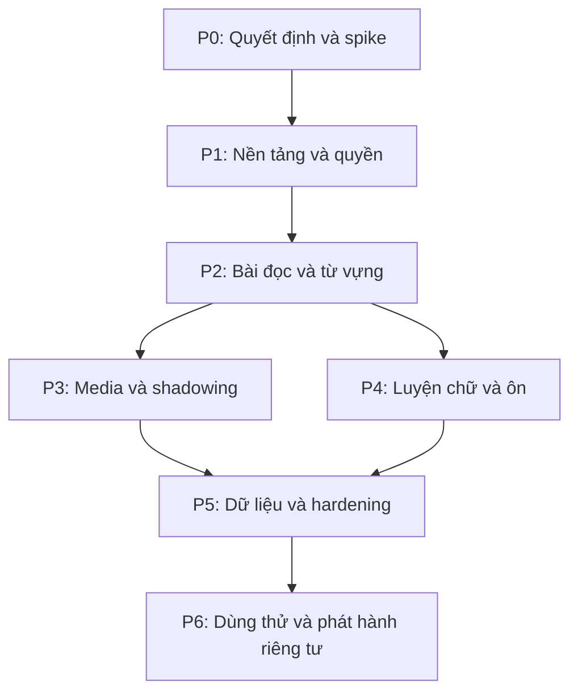

# Kiko — Implementation Plan

**Phiên bản:** 1.0 — Proposed baseline  
**Ngày:** 16/10/2026  
**Mục tiêu:** Triển khai theo lát cắt nhỏ, có bằng chứng nghiệm thu, cho Trung (`zh`), Nhật (`ja`), Anh (`en`).  
**Trạng thái (17/10/2026):** KIKO-005 xong (bootstrap). KIKO-001 một phần (`DECISIONS.md`). KIKO-004 phần auth/DB: kiểm chứng offline và đọc DB dev, còn chờ áp migration và thử OTP thật. KIKO-006/007 đang làm (lát cắt 1: đăng nhập → admission → onboarding → dashboard). Chưa có deployment.

## 1. Cách sử dụng và phạm vi

Đọc cùng `AGENTS.md`, `PROJECT_SPEC.md`, `ARCHITECTURE.md`, `ACCESS_CONTROL.md`. Những file này đã được soạn trong cuộc trò chuyện nhưng chưa mặc định nằm trong một repo đã khởi tạo. Khi đưa vào repo, giữ đúng tên và cập nhật liên kết. Spec v1.0 còn gộp Owner/Learner; phải đồng bộ với thiết kế hai role và quyền sở hữu trước code auth.

Đây là kế hoạch đề xuất, chưa phải lịch cam kết. Không gán ngày hoặc số giờ giả khi chưa biết năng lực triển khai và thời gian thực tế. Bắt đầu bằng kiểm chứng kỹ thuật, sau đó xây một luồng học xuyên suốt; không giao AI xây toàn bộ Kiko trong một prompt.

MVP: đăng nhập, ba ngôn ngữ, bài văn bản/media, phụ đề, lưu từ, shadowing/thu âm, luyện chữ zh/ja, ôn từ, tiến độ, xuất/khôi phục. AI chấm điểm, hội thoại AI, chép chính tả tự động, offline đầy đủ và app native chưa chặn MVP.

## 2. Quy tắc thực hiện

- Mỗi slice có phạm vi, đầu ra, test và gate. Hoàn thành hoặc ghi rõ blocker trước khi chuyển việc phụ thuộc.
- Quyết định kỹ thuật chưa chốt được ghi ADR; một spike không tự trở thành quyết định sản phẩm đã duyệt.
- Agent đọc code và trạng thái repo thực tế, không giả định thư mục/lệnh/package đã tồn tại.
- Ưu tiên dữ liệu synthetic, tài nguyên nhỏ có quyền sử dụng; không dùng bản thu riêng thật cho fixtures.
- Không sửa scope hoặc giảm bảo mật để đánh dấu task hoàn tất.
- Local code/migration files/test disposable được thực hiện trong task đã giao; shared/production migration, deployment, công khai dữ liệu và thay đổi quyền theo authorization hiện hành.
- Không bắt buộc commit/push/merge nếu người dùng chưa yêu cầu. Không thay đổi công việc chưa commit của người khác.
- `DONE` cần evidence; build thành công không thay kiểm thử nghiệp vụ và quyền.

## 3. Phụ thuộc tổng thể



P3 và P4 chỉ độc lập sau khi hợp đồng content/identity/vocabulary ổn định; không mặc định cần nhiều agent. Một người có thể làm tuần tự. Export/restore phải được thiết kế schema từ sớm nhưng hoàn thiện sau các module có dữ liệu ổn định.

## 4. Definition of Ready / Done

### Ready

- Có mục tiêu một câu và yêu cầu FR liên quan.
- Các phụ thuộc đã đạt hoặc có mock contract được ghi rõ.
- Quyết định chặn được chốt, hoặc chỉ đang làm spike không ràng buộc.
- Biết phạm vi dữ liệu và quyền; có tiêu chí chấp nhận/test âm.
- Task vừa đủ để review trong một diff có chủ đích.

### Done

- Luồng thực hoạt động, không chỉ màn hình với dữ liệu giả.
- Validation, quyền, empty/loading/error/unsaved states cần thiết đã có.
- Kiểm thử phù hợp chạy thật, kết quả và lệnh được ghi; phần không chạy được có lý do.
- Không có secrets/private fixtures/generated noise trong diff.
- Cập nhật schema/config/docs khi hành vi đổi; không có quyết định quan trọng bị giấu.
- Không tuyên bố deployment/migration/backup thành công nếu chưa xác minh.

Spike Done nghĩa có kết luận và evidence, không có nghĩa production-ready. Feature bị disable có chủ đích không được ghi như đã hỗ trợ đầy đủ.

## 5. P0 — Quyết định và kiểm chứng kỹ thuật

### KIKO-001 — Đồng bộ tài liệu và decision register

**Phụ thuộc:** Không. **Đối chiếu:** Spec §1, §5, §17; Architecture ADR; Access Control.

**Công việc:**

1. Đưa đúng các tài liệu vào repo đã xác định; chưa có repo thì chuẩn bị cây tài liệu local, không bịa remote URL.
2. Đồng bộ RBAC OWNER/LEARNER + ownership; xác định tài khoản đầu có cả hai.
3. Ghi Proposed/Accepted/Deferred cho stack, package manager, auth, DB/migration ownership, hosting, thiết bị, nguồn media và giới hạn.
4. Chốt bộ nội dung mẫu cho ba ngôn ngữ; UI tiếng Việt vẫn là đề xuất cần xác nhận.

**Đầu ra:** Decision register/ADR, danh sách mâu thuẫn đã xử lý và blocker.

**Gate:** Không có xung đột phân quyền; không coi provider/giá/gói/phiên bản là đã xác minh nếu chưa tra tài liệu chính thức. Chỉ hỏi những quyết định thực sự chặn triển khai.

### KIKO-002 — Spike audio/player/micro

**Phụ thuộc:** Chọn thiết bị/browser thử nghiệm; không cần backend hoàn chỉnh.

**Công việc:** thử file audio/video nhỏ, phát theo khoảng thời gian, loop, tốc độ, nghe rồi nhắc lại, nói đuổi theo, recorder MIME, permission denial, giải phóng tracks và navigation. Thử loa/tai nghe và browser trên thiết bị chính. Không tự xin micro khi mở trang.

**Đầu ra:** Ma trận thiết bị/browser/codec, sai số đo loop, format/size/duration đề xuất, hạn chế và phương án fallback.

**Gate:** Có ít nhất một cấu hình dùng được; giới hạn đã ghi rõ. Sai số mục tiêu dưới 250 ms là đề xuất từ kiến trúc, chỉ áp dụng thiết bị đã đo; nguồn embed có thể cần tiêu chí khác. Không bật hỗ trợ mọi trình duyệt chỉ vì một máy chạy được.

### KIKO-003 — Spike vùng viết và dữ liệu nét

**Phụ thuộc:** Thiết bị, chuột/ngón tay/bút mục tiêu.

**Công việc:** render ô viết, pointer capture/cancel, undo/clear, resize; thử vài ký tự zh/ja từ nguồn có giấy phép. Kiểm tra license/version/attribution/độ phủ; phân biệt chữ Trung và kanji.

**Đầu ra:** Mẫu kỹ thuật có thể bỏ đi, nguồn dataset được đánh giá, trạng thái thiếu dữ liệu.

**Gate:** Viết không cuộn trang trong ô; ngoài ô vẫn cuộn; tọa độ hiển thị lại đúng. Nếu chưa có nguồn nét hợp lệ, tiếp tục nền tảng nhưng ghi blocker cho phần hướng dẫn nét, không tạo nét giả.

### KIKO-004 — Spike auth/storage/runtime

**Phụ thuộc:** Danh sách provider đề xuất.

**Công việc:** kiểm tra auth session server, allowlist/bootstrap, DB pooling/role/RLS, storage signed upload/read/no-overwrite/finalize và giới hạn hosting/worker. Chỉ dùng môi trường disposable được phép.

**Đầu ra:** ADR stack đã review, sơ đồ identity, mô hình quyền runtime, giới hạn file/quota/expiry, nhu cầu worker và chi phí theo gói thực tế nếu chọn.

**Gate P0:** Chốt tối thiểu auth, schema ownership, storage upload semantics và target device trước các slice phụ thuộc. Những lựa chọn chưa cần như AI có thể Deferred.

## 6. P1 — Nền tảng và bảo vệ truy cập

### KIKO-005 — Bootstrap repository và quality checks

**Phụ thuộc:** 001, phần stack của 004.

**Công việc:** khởi tạo theo stack đã chọn; một lockfile; strict typing phù hợp; lint/typecheck/test/build thực sự có script; `.env.example` placeholders, ignore secret/media/dump; README chạy local. Dùng cấu trúc module vừa đủ, không thêm Redis/vector DB/AI SDK chưa cần.

**Đầu ra:** App shell chạy được, CI checks không dùng credentials production, hướng dẫn môi trường.

**Nghiệm thu:** Clone/install từ lockfile và chạy được theo README; CI không chứa secrets. Chỉ claim build/test thực sự đã chạy. Không deploy public như tác dụng phụ.

### KIKO-006 — Auth, admission, role và policy core

**Phụ thuộc:** 005, auth decision 004, policy aligned 001. **FR:** FR01.

**Công việc:** session verification, AllowedAccount states, UserRole, fixed permission registry, authorization revision, controlled first-owner bootstrap và helper quyền server. Role không do form/profile/import quyết định. UI đăng nhập, sign-out, denied, expired session.

**Nghiệm thu:** Anonymous và authenticated-unapproved bị chặn; active Owner-only không đọc private learning; Learner truy cập quyền của mình; tài khoản đầu có cả hai theo bootstrap tin cậy. Suspend/role revoke chặn request tiếp theo theo policy; hai request không thể loại bỏ hết active Owners.

**Tests:** Synthetic A Owner+Learner, B Learner, C Owner-only, D suspended, E unapproved. Test mass assignment, stale roles, bootstrap không mở cho first visitor.

### KIKO-007 — Schema nền, owner scope và ngôn ngữ

**Phụ thuộc:** 006. **FR:** FR01–02, FR05.

**Công việc:** migration local cho profile/language/preference/lesson/vocabulary cơ bản; owner/language invariants; role runtime/migration tách; RLS/grants theo exposed paths; seed synthetic zh/ja/en. Định nghĩa archive, timestamp UTC và schema version export ngay từ đầu.

**Nghiệm thu:** Lưu riêng zh/ja/en, từ giống mặt chữ không tự gộp; không nối chéo owner. Migration test trên DB disposable, NULL/negative tests. Không chạy schema push/reset trên database không rõ môi trường.

**Gate P1:** Nền tảng auth/ownership có test thực và schema tái lập được; không bắt đầu media trên nền phân quyền giả.

## 7. P2 — Lát cắt đầu tiên: bài đọc → lưu từ → mở lại

### KIKO-008 — Lesson CRUD và library

**Phụ thuộc:** 007. **FR:** FR02, FR04.

**Công việc:** tạo bài văn bản theo ngôn ngữ, title/source/tags, draft/ready/archive, list pagination/filter, đọc và sửa. Chặn đổi language khi có dependencies. Giao diện dựa trên UI contract nhỏ, không cần toàn bộ design system trước.

**Nghiệm thu:** Chủ dữ liệu tạo/mở lại/sửa/archive; Learner khác không thấy list/count/detail; thiếu title/language có lỗi rõ; script HTML không thực thi. Có bài mẫu cả ba ngôn ngữ.

### KIKO-009 — Vocabulary, pronunciation, deck và occurrence

**Phụ thuộc:** 008. **FR:** FR04–05.

**Công việc:** chọn cụm từ thủ công; lưu nguyên văn/offset convention/snapshot; nghĩa/cách đọc thủ công; nhiều notation phù hợp; deck membership; cảnh báo trùng thay vì auto merge. Có thao tác xem/sửa/archive, unlink khỏi deck không xóa từ.

**Nghiệm thu:** zh/ja không cần khoảng trắng; IPA/pinyin/kana hiển thị được; cross-owner/cross-language links bị chặn; nguồn câu giữ nguyên sau sửa bài. Lưu rồi reload/đăng nhập lại vẫn còn.

### KIKO-010 — Shared catalog tối thiểu và scope

**Phụ thuộc:** 008–009. **FR:** FR02, quyền catalog trong Access Control.

**Công việc:** triển khai bản tối thiểu draft/published/retired theo quyết định đã review; Owner quản lý, Learner đọc published. Nội dung mẫu có thể dùng shared catalog này. Không có peer sharing. Chuyển từ private sang catalog là bản sao có lựa chọn và quyền, không toggle toàn bộ visibility.

**Nghiệm thu:** Owner-only đọc/sửa catalog được nhưng không đọc private của B; Learner không đọc draft; publish không mang theo recordings/notes/progress; history/private copy giữ snapshot. Nếu catalog được quyết định Deferred cho MVP, ghi scope change rõ và dùng personal fixtures, không đánh dấu task Done giả.

**Gate P2 — First usable slice:** Đăng nhập → chọn ngôn ngữ → tạo bài → đọc/chọn cụm → lưu từ/deck → mở lại dữ liệu. Đây là bản demo đầu tiên dùng để review UX và nền tảng.

## 8. P3 — Media và shadowing

### KIKO-011 — Storage reservation/finalization

**Phụ thuộc:** 004, 007, media ownership contract 008. **FR:** FR03, FR07.

**Công việc:** MediaAsset/UploadReservation, private key server-generated, size/type/purpose/quota checks, direct upload, immutable finalize, cleanup pending/orphan và metadata status. Cơ chế cleanup có runtime thực, không chỉ code không được chạy.

**Nghiệm thu:** Không phát file chưa ready; không finalize key/reservation của người khác; upload lại không thay bytes đã verify; retry không trùng; storage success + DB failure phục hồi được; expired staging được dọn. Quota race được test. URL tạm hết hạn, không lưu như ID.

### KIKO-012 — Transcript import và versioning

**Phụ thuộc:** 008, 011. **FR:** FR03–04.

**Công việc:** SRT/VTT parser và nhập câu thủ công; staging/preview/errors; start/end cùng null hoặc hợp lệ; duration bounds khi biết; overlap warning; draft revision/publish active pointer atomically. Không fetch mọi URL backend.

**Nghiệm thu:** File hỏng không công bố bài ready; text không time vẫn đọc được; time hợp lệ mới luyện theo câu; sửa version không sửa lịch sử cũ. Parser limits và NULL checks có test âm. Một bài audio có phụ đề mỗi ngôn ngữ.

### KIKO-013 — Player và recorder hoàn chỉnh

**Phụ thuộc:** 002, 011–012. **FR:** FR06–07.

**Công việc:** chọn/chuyển/lặp câu, tốc độ đã hỗ trợ; nghe-nhắc và nói đuổi; recorder lifecycle, local buffer, upload/retry, listen/delete/history. Gắn snapshot câu/time/source vào attempt.

**Nghiệm thu:** Từ chối micro vẫn nghe được; không tự thu; đổi bài xử lý recording rõ; local-only/saved phân biệt; local chưa xác nhận không bị xóa; account switch không upload dưới owner khác; tracks và object URLs được giải phóng. Thiết bị mục tiêu được thử lại sau tích hợp, không chỉ dựa spike.

### KIKO-014 — Lỗi media và hành vi phục hồi

**Phụ thuộc:** 013. **FR:** FR06–07, FR12.

**Công việc:** mất mạng, unsupported format, quota, nguồn không phát được, page close, retry finalize, deleted source và cleanup UI. Local persistence capability-detect; không hứa browser lưu vĩnh viễn. Tạo failure fixtures/hướng dẫn manual checks.

**Gate P3:** Có bài zh/ja/en nghe-lặp-thu-nghe lại và lưu bền vững; kiểm tra private download và partial failure đạt. Không yêu cầu điểm phát âm.

## 9. P4 — Luyện viết, ôn tập và tiến độ

### KIKO-015 — Writing dataset và ô luyện chữ

**Phụ thuộc:** 003, 007, 009. **FR:** FR08.

**Công việc:** Character/StrokeDataset/version/license, vocabulary-character mapping; xem mẫu, đồ, ẩn mẫu, free write, undo/clear, save/self-rating. Dataset tải theo nhu cầu, không nhúng bộ lớn không kiểm tra license.

**Nghiệm thu:** Một tập nhỏ zh/ja hoạt động; missing dataset có fallback rõ; không hiện stroke lesson cho en; không gắn nhãn đúng nét/chữ đẹp giả. Input chuẩn hóa/size limits/pointer cancel và privacy tests đạt. Nguồn chưa hợp lệ là blocker phần hướng dẫn nét, không tự copy từ ứng dụng thương mại.

### KIKO-016 — Review engine và queue

**Phụ thuộc:** 009, chốt lịch v1. **FR:** FR09.

**Công việc:** card directions, explicit add-to-review, due queue, reveal/rating, event idempotency, card optimistic version, atomic schedule/history, algorithm_version. Quy tắc interval theo spec chỉ dùng sau review; không tự thay bằng algorithm khác.

**Nghiệm thu:** Chưa reveal không submit; duplicate event chỉ một effect; concurrent stale tab conflict; Quên/Khó/Nhớ và bậc cuối đúng; UTC/due grouping timezone đúng; archived item không vào queue; owner khác không sửa schedule.

### KIKO-017 — Progress và learn-again navigation

**Phụ thuộc:** 013, 015–016. **FR:** FR10.

**Công việc:** hoạt động gần đây, unique items vs attempts, due count, filter language, câu khó và học tiếp. Không tự coi mở bài là hoàn thành. Chỉ hiển thị học phút nếu đo active time rõ và được test; nếu chưa đáng tin thì bỏ metric đó.

**Gate P4:** Luồng nội dung → từ → shadowing → luyện chữ zh/ja → ôn hoạt động; en không bị ép vào module nét; progress tách ngôn ngữ và không tự nhận là điểm trình độ.

## 10. P5 — Dữ liệu, vận hành và hardening

### KIKO-018 — Export có version và bytes

**Phụ thuộc:** Các schema P3/P4 ổn định. **FR:** FR11.

**Công việc:** snapshot/cutoff, schema_version, manifest/checksum, JSON + recording bytes, source-reference/license notes, private artifact và expiry. Không export token/signed URL/admin config.

**Nghiệm thu:** Hồ sơ A không chứa B, export đủ quan hệ, kiểm tra nguồn catalog reference-only, download đúng owner và artifact expired bị chặn. File lớn xử lý theo limit/runtime, không ép vào memory không giới hạn.

### KIKO-019 — Restore staged vào hồ sơ trống

**Phụ thuộc:** 018, worker/runtime nếu cần. **FR:** FR11.

**Công việc:** ZIP/path/symlink/size/count limits, schema compatibility, preview, owner remap, ID mapping, staging visibility, transactional publish và cleanup. Hồ sơ trống là learning profile trống, không xóa role/account để restore.

**Nghiệm thu:** Round-trip zh/ja/en gồm bản thu; reject foreign roles/owner claims, malformed relation và ZIP traversal/bomb; retry import_id không duplicate; failure không hiện dữ liệu nửa chừng; không tự merge vào hồ sơ đang có dữ liệu.

### KIKO-020 — Archive/delete và vận hành storage

**Phụ thuộc:** 011, 015–019. **FR:** FR12.

**Công việc:** xác nhận xóa theo phạm vi; archive vs hard delete; pending_delete retry; orphan sweeper; history dependency; counters dung lượng. Thiết kế account deletion riêng nếu có nhu cầu, không gộp vào Owner remove-account.

**Nghiệm thu:** Xóa recording không xóa lesson; không tạo URL mới sau delete; signed link cũ có expiry được ghi rõ; cleanup thất bại có retry; không cascade mất history ngoài ý muốn.

### KIKO-021 — Observability, backup và cấu hình bảo mật

**Phụ thuộc:** 005–020 theo bề mặt đã có.

**Công việc:** request/error IDs, redact log, auth/admin audit, DB/storage/job metrics, quota; secret store, security headers, cache isolation, CI checks, backup cả metadata+file và runbook restore.

**Nghiệm thu:** Không có private lesson/audio/secret trong log; Owner ops chỉ metadata; cache account switch không lộ dữ liệu. Có diễn tập restore ở môi trường cô lập. RPO 24h/RTO 1 ngày từ kiến trúc chỉ là mục tiêu, phải có cơ chế thực và evidence trước claim.

### KIKO-022 — Kiểm thử bảo mật và regression E2E

**Phụ thuộc:** Feature surfaces tương ứng; kiểm tra sớm theo từng slice, không chờ cuối mới bắt đầu.

**Công việc:** thực hiện matrix trong ACCESS_CONTROL.md: anonymous/unapproved/suspended, A/B/C roles, IDOR, nested IDs, direct data/storage path, export scope, revocation/jobs, mass assignment, race last Owner. Thêm XSS, CSRF/origin theo auth flow, SSRF nếu có URL adapter, import và retry failures.

**Nghiệm thu:** Findings nghiêm trọng được sửa và regression test; không giảm test để pass. Không claim security audit hoàn chỉnh chỉ vì scanner không báo. Retest media/pointer trên thiết bị thật và smoke ba ngôn ngữ.

**Gate P5:** Checklist kỹ thuật đạt; xuất/khôi phục và cross-owner isolation có evidence; blockers còn lại được phân loại rõ.

## 11. P6 — Dùng thử và phát hành riêng tư

### KIKO-023 — Chuẩn bị bản private review

**Phụ thuộc:** P5 gate.

**Công việc:** README/env/migration/runbooks hoàn chỉnh; dependency/license list; danh sách hạn chế; exact deployment plan và target/audience. Nếu deploy được ủy quyền, dùng environment riêng tư đã chọn và xác minh health/smoke sau deploy. Nếu chưa được phép, cung cấp bản review local và checklist, không tự mở public.

**Nghiệm thu:** Audience/DB target đúng; không chia sẻ production secrets; migration execution được phép riêng khi cần; có rollback code và recovery data plan, không coi rollback code là đảo ngược DB tự động.

### KIKO-024 — Pilot cá nhân 2 tuần

**Phụ thuộc:** Bản dùng được, local hoặc private deployment.

**Công việc:** mục tiêu 4 buổi/tuần là đề xuất thử; ghi task học, lỗi, thao tác khó, nội dung thiếu và chi phí/storage thực. Không cần telemetry ngoài hoặc ghi bản thu làm analytics.

**Nghiệm thu:** Có nhật ký ngắn, ưu tiên sửa theo cản trở học; kiểm chứng một lần restore; đánh giá tiếp tục dùng được. Không suy ra hiệu quả giáo dục hoặc trình độ từ pilot này.

### KIKO-025 — Chốt baseline MVP và backlog sau

**Phụ thuộc:** 024.

**Công việc:** review FR01–FR12, cập nhật docs theo thực tế, đánh dấu deferred; tổng hợp evidence và quyết định phát hành tiếp. Nếu gọi version/release, chỉ tạo theo quy trình/authorization của repo.

**Gate P6:** Chủ dự án có bản Kiko đủ dùng với hạn chế rõ; không cần tất cả ý tưởng tương lai để chốt MVP.

## 12. Sau MVP — không tự đưa vào scope

| Epic | Điều kiện mở |
|---|---|
| Chép chính tả và viết câu | Luồng nội dung ổn định; có quy tắc so sánh/feedback và UI riêng |
| Tra từ/tokenization tự động | Nguồn/license/locale đã đánh giá; kết quả sửa được |
| Tạo/căn phụ đề | Worker, provider, cap, retention và quality benchmark |
| Kiểm tra nét | Dataset đủ và test dung sai; phân biệt với chữ đẹp |
| Chấm phát âm | Kiểm chứng riêng zh/ja/en, dữ liệu gửi và chi phí; không dùng ASR match thay điểm |
| Hội thoại AI | Conversation privacy, quotas, cancellation, lỗi và nội dung an toàn |
| Offline/PWA nâng cao | Conflict resolution, local isolation, quota/storage eviction và logout |
| Nhiều người dùng | Admission, lifecycle, cost, privacy/support; không tự mở đăng ký công khai |

## 13. Ma trận truy vết

| Spec | Task chính | Bằng chứng |
|---|---|---|
| FR01 | 006–007, 022 | Auth/admission/ownership tests |
| FR02 | 008, 010 | CRUD + scope + archive |
| FR03 | 011–012 | Media/import validation |
| FR04 | 008–009, 012 | Read/select/Unicode/sanitize |
| FR05 | 009 | Deck/word/reading/source integrity |
| FR06 | 013–014 | Device shadowing flow |
| FR07 | 011, 013–014 | Upload/finalize/retry |
| FR08 | 003, 015 | Dataset license + pointer checks |
| FR09 | 016 | Version/idempotency/interval tests |
| FR10 | 017 | Counts/time semantics by language |
| FR11 | 018–019 | Export/restore round-trip |
| FR12 | 020 | Archive/delete/cleanup |
| FR13 | Sau MVP | Spec riêng trước triển khai |

## 14. Cách giao việc cho AI coding agent

Mỗi lần giao một slice hoặc một phần nhỏ đã có Ready. Ví dụ:

```text
Đọc AGENTS.md, PROJECT_SPEC.md, ARCHITECTURE.md,
ACCESS_CONTROL.md và task KIKO-008 trong IMPLEMENTATION_PLAN.md.
Kiểm tra trạng thái repo và các quyết định Accepted.
Thực hiện KIKO-008 trong phạm vi đã mô tả, giữ nguyên phần ngoài scope.
Nếu gặp quyết định chặn, nêu bằng chứng và tiếp tục việc độc lập an toàn.
Kiểm thử acceptance criteria gồm quyền sở hữu và error states.
Báo cáo thay đổi, checks thực sự chạy, limitations và task còn lại.
Không mặc định được deploy hoặc chạy migration lên database dùng chung.
```

Không yêu cầu agent “cứ build hết” hay tự chọn mọi provider. Nếu context hết, agent đọc trạng thái và tài liệu hiện tại; không dựa vào lời hứa hoặc memory của lần trước.

## 15. Theo dõi tiến độ và evidence

Trạng thái đề xuất: TODO → READY → IN_PROGRESS → IN_REVIEW → DONE; BLOCKED có blocker/owner/điều kiện mở. Không tự đánh DONE trong file khi chưa có bằng chứng. File này là kế hoạch; tracker có thể ở issues hoặc một bảng đơn giản, không cần copy toàn bộ task sang nhiều nơi dễ lệch.

Mẫu ghi nhận một task:

```text
Task: KIKO-___
Status: TODO
Decision dependencies:
Changed files / PR / commit (nếu có):
Acceptance criteria covered:
Checks executed + actual results:
Manual device evidence (nếu cần):
Unverified / known limitations:
Data/environment mutations performed:
Remaining blocker and next action:
```

Mẫu task review nên mô tả final behavior, không chỉ liệt kê code. Security và data migration changes cần có test âm và recovery impact.

## 16. Rủi ro, gate và điều chỉnh kế hoạch

| Rủi ro | Phản ứng |
|---|---|
| Audio/browser không đạt | Giới hạn supported matrix hoặc đổi mode; không hứa hỗ trợ toàn bộ |
| Dataset không hợp lệ/thiếu | Chặn hướng dẫn nét tương ứng, tiếp tục phần độc lập |
| Scope quá lớn | Giảm số nội dung mẫu, giữ luồng cốt lõi; thay đổi feature cần ghi decision |
| Auth/RLS mismatch | Dừng phần phụ thuộc quyền, sửa/test nền tảng trước |
| Hosting không chạy worker | Chọn runtime hoặc giữ feature dài disabled; không để job chạy giả |
| Chi phí/file tăng | Quota/counters/cleanup; không tự nâng gói |
| Specs mâu thuẫn | Review và đồng bộ, không chọn im lặng |
| Test không chạy do môi trường | Ghi blocker và check thay thế có giới hạn; không báo pass |

Sau P0 mới ước lượng theo evidence, số slice và thời gian rảnh thực tế. Re-estimate sau first usable slice và media integration; không để lịch giả thúc đẩy bỏ kiểm tra quyền hoặc sao lưu.

## 17. Lịch sử phiên bản

| Phiên bản | Ngày | Nội dung |
|---|---|---|
| 1.0 Proposed | 16/10/2026 | Kế hoạch Kiko theo 25 task, gates, dependencies, traceability và pilot; tất cả chưa bắt đầu |
