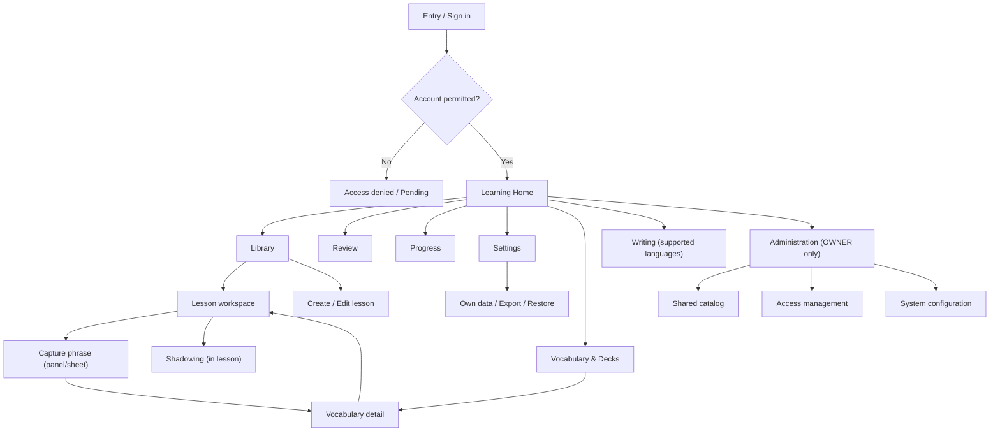

# Kiko — Information Architecture (IA)

**Version:** 0.1 | **Date:** 2026-10-19 | **Status:** Proposed UX architecture; pending user testing and owner approval
**Primary market:** Vietnamese-speaking learners | **Platform:** Responsive web
**References:** PROJECT_SPEC.md, PRD.md, UI_SPEC.md, ACCESS_CONTROL.md, USER_RESEARCH_SYNTHESIS.md, PERSONAS_AND_JTBD.md, FEATURE_PRIORITIZATION.md, USER_JOURNEY_MAP.md

## 1. Goal and constraints

Organize information so learners can **start, continue, capture, review and retrieve context** without navigating through unrelated features. This document defines **navigation and content hierarchy**, not visual layouts, backend implementation or approved new feature scope.

Constraints:
- Current technical baseline: Chinese (zh), Japanese (ja), English (en). French/Korean remain future candidates.
- OWNER and LEARNER permissions are distinct; OWNER does not gain access to others' private learning records.
- Existing private-by-default admission rules remain; public registration is not implied.
- Guided vs content-first entry remains an **experiment**; do not assume two separate systems.
- AI speaking, live classes, exam tracks, social and payments are not added to the MVP.
- Routes below are **proposed IA contracts**, not claims that pages are implemented.

## 2. Primary mental model

A learner should be able to answer:
1. **What can I do now?** → Home (resume, next activity, due reviews).
2. **What am I learning from?** → Library → Lesson workspace.
3. **What have I saved?** → Vocabulary → Word detail and source.
4. **What should I remember?** → Review.
5. **How am I doing?** → Progress (real actions and recall, not unvalidated proficiency).
6. **What can I control?** → Settings (language, privacy, own data).

**Core content relationships:**
- Language scopes lessons, vocabulary, review and progress.
- Lesson has content and optional media/transcript versions.
- Saved phrase references a source snapshot and optional lesson/segment/timestamp.
- Review card references a vocabulary item and review events.
- Shadowing attempt belongs to a lesson/segment and learner.
- Writing exercises appear only for supported language capabilities.

Do not equate a lesson with a deck, a saved word with a learned word, or activity with proficiency.

## 3. Proposed sitemap

**Notes:** Capture is an overlay/panel, not necessarily a standalone route. Shadowing is a mode within the lesson workspace. A catalog is clearly distinguished from a learner's private library. Administration is a separate navigation area.

## 4. Navigation hierarchy and route mapping

| Level | Section | Route candidate | Main information / action | Access |
|---|---|---|---|---|
| Global | Home | `/` | Resume, current language, next activity, due review | LEARNER |
| Global | Library | `/library` | Own lessons, permitted catalog, filters, create | LEARNER |
| Global | Vocabulary | `/vocabulary` | Saved phrases, decks, search/filter | LEARNER |
| Global | Review | `/review` | Due queue and recall session | LEARNER |
| Global | Progress | `/progress` | Activities, review evidence per language | LEARNER |
| Secondary | Writing | `/writing` | Script/character practice when supported | LEARNER |
| Global utility | Settings | `/settings` | Language preferences, account, privacy, own data | Authorized actor |
| Contextual | Lesson | `/lessons/:id` | Read/listen, capture, shadowing | Owning LEARNER |
| Contextual | Lesson editor | `/lessons/new`, `/lessons/:id/edit` | Create/edit content, transcripts | Owning LEARNER |
| Contextual | Vocabulary detail | `/vocabulary/:id` | Meaning, reading, original source, edit/archive | Owning LEARNER |
| Contextual | Catalog lesson | `/catalog/:id` | Published shared lesson | Per catalog policy |
| Auth | Sign in | `/sign-in` | Authenticate | Anonymous |
| Auth | Access denied | `/access-denied` | Explain restricted account state safely | Restricted actor |
| Admin | Catalog | `/admin/catalog` | Shared content lifecycle | OWNER |
| Admin | Access | `/admin/access` | Account roles and admission | OWNER |
| Admin | System | `/admin/system` | Configuration and quotas | OWNER |

Routes align with the existing UI_SPEC baseline; actual paths should be reconciled with implemented code before delivery. **Do not create a new public onboarding or AI route solely because it appears in a prototype.**

## 5. Desktop and mobile navigation proposals

### Desktop (wide)
- Persistent sidebar: Home, Library, Vocabulary, Review, Progress.
- Secondary area or More: Writing (if supported), Settings.
- Header: Kiko identity, selected language, account.
- OWNER administration: visually separated section; never mix admin actions with private learner content.
- Contextual lesson: preserve lesson title, language, back-to-library, and compact study actions.

### Mobile (compact)
- Bottom navigation **candidate:** Home, Library, Review, More.
- More: Vocabulary, Progress, Writing (if supported), Settings.
- Header: current language, account; avoid overcrowding.
- Capture: bottom sheet/full-screen when needed; do not cover selected sentence or keyboard.
- During study: reduce persistent navigation obstruction, keep back and primary action discoverable.

**Decision to test:** Is Vocabulary used often enough to deserve a mobile bottom-nav slot instead of More? Compare task completion and findability. Do not lock this without testing.

## 6. Information hierarchy by key screen

### 6.1 Learning Home
1. Current learning language and switch control.
2. **Primary action:** Resume last lesson or start first lesson.
3. Due review summary and start review.
4. Library entry and recent lessons.
5. Lightweight activity/recall summary; no invented proficiency score.

States: first use, no due items, interrupted lesson, no content, loading/error, language switched.

### 6.2 Library
1. Page title, current language, create/open action.
2. Search/filter and clear ownership labels: **My lessons** vs **Shared catalog**.
3. Lesson title, source/type, status, last activity.
4. Empty-state suggestion to create/open a sample lesson.

States: empty, filtered empty, archived, unsupported media, no permission, loading/error.

### 6.3 Lesson workspace
1. Lesson identity, language and source information.
2. Main readable text/transcript and optional player.
3. Contextual sentence/phrase selection.
4. Save vocabulary action and source snapshot.
5. Shadowing controls only where supported.
6. Optional related words and navigation to review.

Avoid displaying all secondary tools simultaneously; prioritize content comprehension.

### 6.4 Vocabulary / word detail
1. Saved word or phrase and language.
2. Meaning, reading/notation (if available).
3. **Original context**: source sentence, lesson/version, optional timestamp.
4. Actions: review, edit, archive, return to lesson.
5. Deck membership, if relevant.

Distinguish an original historical snapshot from a current edited lesson.

### 6.5 Review
1. Due queue count and selected language.
2. One recall prompt.
3. Reveal answer and source context.
4. Self-assessment/response and next item.
5. Completion summary and next useful action.

Never show a “mastery” score unless supported by an explicitly validated model.

### 6.6 Progress
1. Selected language and reporting period.
2. Completed activities vs saved items vs review attempts.
3. Due review and retrieval evidence where available.
4. Recent learning history and continue action.

### 6.7 Settings / privacy
1. Account and language preferences.
2. Recording and optional external-AI processing explanation/controls.
3. Data export/restore, deletion, confirmations and status.
4. Access or account issues.

## 7. Navigation rules and cross-links

- Keep the current language visible; switching language must not silently relabel or merge lesson/word/review data.
- Return from word detail to **source lesson/context**, preserving a historical snapshot if the source changed.
- Deep links to private resources must enforce server ownership, not rely on hidden UI.
- Preserve safe list filters and scroll context on back navigation where feasible.
- If an action leaves unsaved text or recording, show explicit save/discard/cancel handling.
- A user may open Review directly from Home or Vocabulary; do not require traversing a lesson.
- Do not expose foreign resource titles in 403/404 messages or navigation breadcrumbs.
- Navigation labels should be tested in Vietnamese: e.g. Trang chủ, Bài học, Từ vựng, Ôn tập, Tiến độ, Cài đặt.
- Keep language selection distinct from the **interface locale**.

## 8. Content taxonomy and metadata

| Object | Primary metadata | Findability / organization |
|---|---|---|
| Language | Code, display name, script/capabilities | Global language selector |
| Lesson | Title, language, source/type, owner/scope, status, tags, updated time | Library search, filters, resume |
| Transcript segment | Text, version, optional timing | Lesson selection and source link |
| Vocabulary item | Phrase, language, meaning, reading, owner, status | Search, deck, recent items |
| Occurrence | Original sentence snapshot, source lesson/version, optional timing | Word detail → source |
| Review card/event | Due time, prompt direction, attempt, response, scheduler version | Review queue and history |
| Shadowing attempt | Lesson/segment, recording status | Contextual lesson history |
| Writing attempt | Character/script, dataset availability | Language-specific writing view |

Metadata should support navigation without exposing private text in public URLs or caches.

## 9. Design variants to test

| Question | Variant A | Variant B | Test task |
|---|---|---|---|
| First entry | Guided goal/language selection | Immediate content-first entry | Reach first meaningful action |
| Main organization | Lesson-centric Home | Activity-centric Home | Resume, capture and review |
| Mobile Vocabulary | In bottom navigation | Under More | Find saved phrase |
| Review discovery | Home due card | Dedicated Review destination | Find due reviews |
| Language switching | Header switcher | Home/settings switcher | Switch and locate correct content |

Compare usability with learners from PP01 and PP02. Record task success, hesitation, misnavigation and comprehension; no invented winner.

## 10. Accessibility, responsive and failure states

- Semantic headings and navigation landmarks, keyboard/focus order, touch targets, screen-reader labels and reduced motion.
- Clear contrast and typography for Vietnamese, IPA, Hanzi, Kana and other supported scripts.
- No hover-only navigation; preserve reading area when mobile keyboard opens.
- Loading, empty, offline/network error, expired session, permission denied, unsupported media, missing reading/stroke dataset, unsaved draft and no-due-review states.
- Explicit microphone permission and storage status; no fake pronunciation grades.

## 11. IA acceptance criteria (for prototype review)

A participant should be able to:
1. Find a lesson or create one from Home/Library.
2. Save a phrase and find it later from Vocabulary.
3. Navigate back to its source context.
4. Start due review from Home or Review.
5. Switch learning language without confusing content.
6. Locate privacy/export controls and understand access boundaries.

Measure task outcomes during usability testing; **no passing rates are claimed**.

## 12. Open decisions and handoff

- Confirm the primary learner segment and pilot language within the existing zh/ja/en baseline.
- Validate Guided vs Content-first onboarding and desktop/mobile navigation.
- Confirm how the Shared catalog is represented when unavailable.
- Review the mobile bottom-nav destinations after task testing.
- Next document: `USER_FLOWS.md` with happy paths, decision points, error paths and explicit screen transitions.

**Change control:** Proposed UX architecture only. No PRD scope, database, access role, deployment or implementation changes are authorized.
