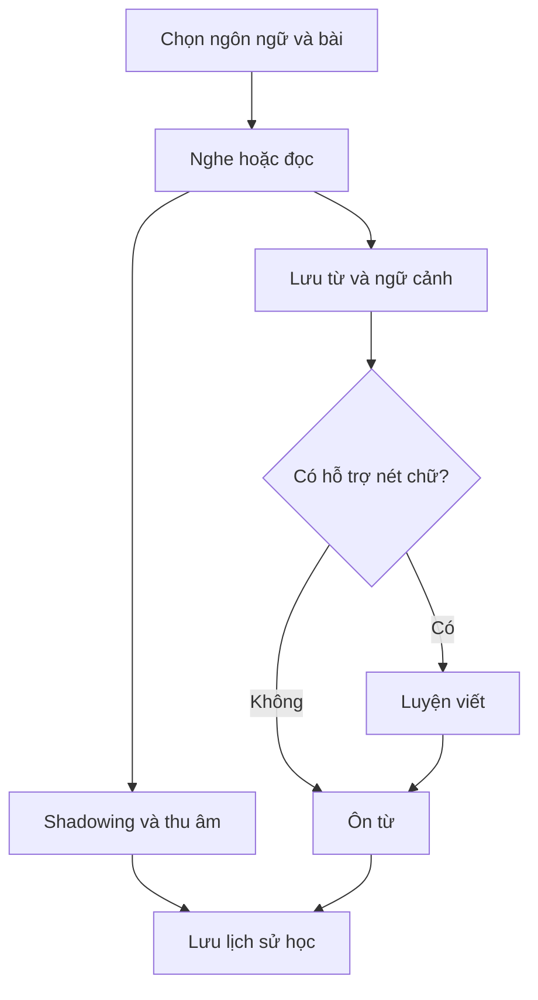
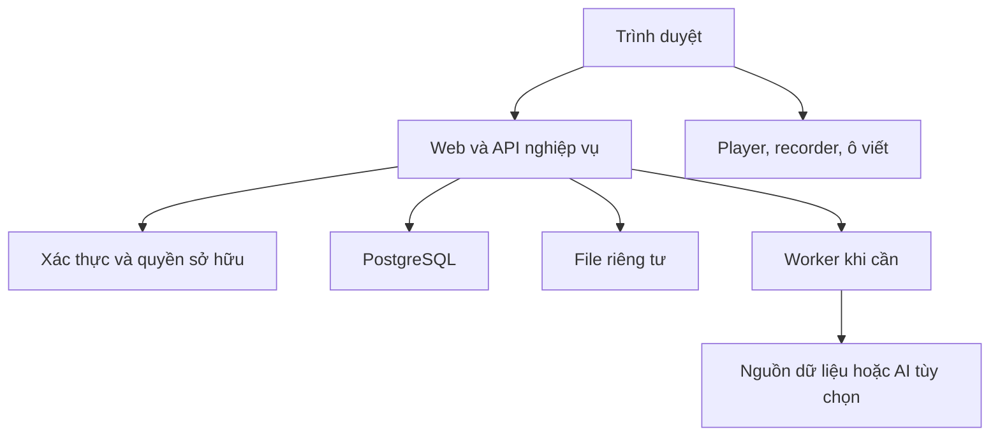

# Kiko — Project Specification

**Phiên bản:** 1.4 — Draft  
**Ngày:** 16/10/2026  
**Chủ dự án:** Vũ Mỹ Kỳ  
**Ngôn ngữ học:** Trung (`zh`), Nhật (`ja`), Anh (`en`)  
**Mục đích:** Đặc tả sản phẩm và nền tảng kỹ thuật để phân rã backlog, thiết kế và triển khai.

## 1. Trạng thái và cách sử dụng tài liệu

- **Đã xác nhận:** tên Kiko; phục vụ cá nhân; hỗ trợ Trung–Nhật–Anh; có từ vựng, đọc, hội thoại, rèn chữ và shadowing; Corodomo là tham khảo cho học qua video và shadowing.
- **Đề xuất:** web responsive trước; giao diện tiếng Việt; stack Next.js/TypeScript/PostgreSQL; phạm vi MVP, quy tắc ôn và tiêu chí kỹ thuật dưới đây.
- **Chưa chốt:** thiết bị chính, hosting, phương thức đăng nhập, dữ liệu nét chữ/từ điển, giản thể/phồn thể, biến thể giọng Anh, ngân sách, offline và nhà cung cấp AI.

Các yêu cầu đánh dấu MVP là đường cơ sở đề xuất, không phải các quyết định đã được chủ dự án phê duyệt riêng. Tài liệu mô tả sản phẩm dự kiến, không tuyên bố chức năng đã được xây hoặc kiểm thử. Repo GitHub chưa được xác nhận tạo thành công trong cuộc trò chuyện.

## 2. Vấn đề và mục tiêu

Kiko là không gian tự học ngoại ngữ giúp kết nối nội dung nghe/đọc với từ vựng, luyện nói, luyện chữ và ôn tập. Người dùng chủ động lựa chọn nội dung và kiểm soát chi phí thay vì phụ thuộc vào nhiều ứng dụng thuê bao.

Luồng trung tâm: **Nội dung → hiểu câu/từ → luyện nói → luyện viết khi phù hợp → ôn lại**. Các kỹ năng vẫn truy cập độc lập.

### 2.1. Mục tiêu nghiệm thu sản phẩm

| Mã | Mục tiêu | Bằng chứng |
|---|---|---|
| G01 | Hỗ trợ cả ba ngôn ngữ | Mỗi ngôn ngữ có một bài mẫu hoàn chỉnh |
| G02 | Liên kết các kỹ năng | Lưu từ từ một câu, luyện câu, ôn từ và mở luyện chữ Trung/Nhật |
| G03 | Dùng được thường xuyên | Thử cá nhân 2 tuần; mục tiêu đề xuất 4 buổi/tuần |
| G04 | Dữ liệu bền vững | Đăng nhập lại vẫn có tiến độ; thử xuất và khôi phục |
| G05 | Kiểm soát chi phí | Luồng cơ bản chạy được khi tắt AI |

Không dùng số ngày học hay số thẻ đã xem để khẳng định trình độ ngoại ngữ.

## 3. Phạm vi phát hành

| Nhóm | MVP | Sau MVP |
|---|---|---|
| Nội dung | Văn bản, file media được hỗ trợ, nhập SRT/VTT, sửa phụ đề | Tự nhận dạng/căn phụ đề, tích hợp nguồn video cụ thể |
| Từ vựng | Tạo/sửa, bộ từ, câu nguồn, cách đọc thủ công | Tra từ tự động và phân tích từ |
| Đọc/hội thoại | Văn bản, hội thoại mẫu, hiện/ẩn nghĩa và chọn cụm từ | Hội thoại tương tác AI, phản hồi viết câu |
| Shadowing | Phát câu, lặp, tốc độ, thu âm và nghe đối chiếu | Chấm phát âm sau kiểm chứng |
| Rèn chữ | Trung/Nhật: nét mẫu với tập dữ liệu nhỏ, đồ/tự viết, tự đánh giá | Kiểm tra hướng/thứ tự/hình dạng nét |
| Chính tả | Chưa bắt buộc | Nghe và gõ lại cho cả ba ngôn ngữ |
| Ôn | Thẻ từ, lịch ôn, lịch sử | Thẻ câu/chữ, thuật toán nâng cao |
| Dữ liệu | Tiến độ, xuất/nhập, file riêng tư | Đồng bộ offline đầy đủ |

Ngoài phạm vi hiện tại: thanh toán, quảng cáo, mạng xã hội, lớp học/giáo viên, chấm chữ đẹp, app native và xử lý mọi URL tùy ý. Học đủ ba ngôn ngữ không đồng nghĩa có sẵn giáo trình lớn cho cả ba.

## 4. Mô hình ngôn ngữ

| Thuộc tính | Trung | Nhật | Anh |
|---|---|---|---|
| Mã | zh | ja | en |
| Cách đọc hỗ trợ | Pinyin, thanh điệu | Kana; furigana theo phần chữ khi có | IPA, biến thể giọng khi biết |
| Luyện nét | Chữ Hán có dữ liệu | Kana/kanji có dữ liệu | Không trong phạm vi |
| Luyện nói | Audio/video nguồn | Audio/video nguồn | Audio/video nguồn |
| Bài tập viết mở rộng | Chính tả/câu | Chính tả/câu | Chính tả/câu |

Ngôn ngữ giao diện tách khỏi ngôn ngữ bài học. Bài học có một ngôn ngữ đích ở MVP; bản dịch tiếng Việt không làm bài thành bài đa ngôn ngữ. Không tự đổi giản thể/phồn thể, gộp chữ Trung với kanji, hoặc mặc định giọng Anh–Mỹ. Cách đọc chưa biết được để trống và sửa được.

## 5. Vai trò và quyền

Phân quyền theo **RBAC kết hợp quyền sở hữu** với hai role cố định `OWNER` và `LEARNER`; chi tiết quyền, phạm vi và kiểm thử nằm trong `ACCESS_CONTROL.md` (tài liệu chuẩn cho phân quyền). Tài khoản cá nhân đầu tiên mang cả hai role qua bootstrap có kiểm soát. Role cho phép hành động; quyền sở hữu quyết định dữ liệu nào được chạm tới. `OWNER` không tự động đọc bản thu, tiến độ hay dữ liệu học riêng của learner khác, kể cả khi MVP mới có một người dùng. Không có bảng phân quyền động, role editor/admin khác hoặc impersonation trong MVP. Không mở đăng ký công khai mặc định.

| Hành động | Chưa đăng nhập | Tài khoản không được phép / bị khóa | `LEARNER` | `OWNER` (không có `LEARNER`) | Worker hệ thống |
|---|---|---|---|---|---|
| Đọc bài/bản thu/tiến độ riêng | Không | Không | Chỉ dữ liệu của mình | Không | Chỉ trong tác vụ được giao |
| Tạo/sửa/xóa nội dung riêng | Không | Không | Chỉ dữ liệu của mình | Không | Chỉ cập nhật đầu ra tác vụ |
| Xuất/khôi phục dữ liệu | Không | Không | Dữ liệu của mình; khôi phục vào hồ sơ trống | Không | Không tự khởi tạo |
| Đọc catalog chung đã published | Không | Không | Có | Có | Không |
| Soạn/publish/retire catalog chung | Không | Không | Không | Có | Không |
| Quản lý tài khoản, role, hạn mức, cấu hình tích hợp/AI | Không | Không | Không | Có, theo ràng buộc (không xóa Owner cuối cùng) | Không |
| Dùng tích hợp cá nhân đã bật | Không | Không | Có, trong hạn mức và luồng dữ liệu đã duyệt | Không | Không |

Backend suy ra user từ phiên, không từ user_id do client gửi. Mọi liên kết con phải cùng chủ sở hữu. Kho file riêng tư; URL tạm chỉ cấp sau kiểm tra quyền. Khóa quản trị/AI không xuất ra frontend. Nếu dùng kết nối database bỏ qua RLS, lớp nghiệp vụ phải kiểm tra đầy đủ; RLS vẫn cần cho đường truy cập trực tiếp nếu tồn tại.

## 6. Cấu trúc màn hình

| Màn hình | Nội dung chính |
|---|---|
| Đăng nhập | Đăng nhập, lỗi, trạng thái tài khoản được phép |
| Trang chủ | Ngôn ngữ, học tiếp, số mục đến hạn, hoạt động gần đây |
| Thư viện | Bài học, bộ lọc ngôn ngữ/chủ đề/trạng thái, tạo bài |
| Soạn bài | Nguồn, media, văn bản/phụ đề, dịch, xem trước |
| Không gian học | Player, câu, bản dịch, từ đã lưu, chuyển sang shadowing |
| Shadowing | Câu hiện tại, lặp/tốc độ, thu/nghe lại, lịch sử |
| Từ vựng | Bộ từ, tìm kiếm, chi tiết, cách đọc, nguồn |
| Luyện chữ | Chọn chữ, nét mẫu, ô viết, xóa, tự đánh giá |
| Ôn tập | Phạm vi ngôn ngữ, câu hỏi, đáp án, mức nhớ |
| Tiến độ | Hoạt động theo ngôn ngữ và thời gian |
| Cài đặt/dữ liệu | Múi giờ, xuất/nhập, dung lượng, tùy chọn tích hợp |

Giao diện ưu tiên đọc rõ chữ và thao tác học. Phong cách, màu, logo chưa chốt. Có empty/loading/error states và thông báo chưa lưu; không báo thành công khi mới lưu tạm tại thiết bị.

## 7. Yêu cầu chức năng và tiêu chí chấp nhận

### FR01 — Truy cập và hồ sơ [MVP]

Đăng nhập, đăng xuất, chọn múi giờ/ngôn ngữ đang học. Phiên hết hạn không được tiếp tục ghi dữ liệu. Có thông báo cho tài khoản không được phép. Múi giờ mặc định đề xuất Asia/Ho_Chi_Minh, có thể chỉnh.

**Chấp nhận:** request không có phiên bị từ chối; sửa ID không truy cập được tài nguyên khác; đăng xuất chặn thao tác mới. Phương thức đăng nhập sẽ chọn trước khi triển khai.

### FR02 — Bài học và thư viện [MVP]

Tạo/sửa tiêu đề, ngôn ngữ, chủ đề, mức độ tùy chọn, ghi chú nguồn; lưu nháp, chuyển sẵn sàng, lưu trữ. Bài văn bản không bắt buộc media; bài shadowing bắt buộc nguồn phát được và câu có thời gian hợp lệ. Mức độ do người dùng gán, không tuyên bố chứng nhận HSK/JLPT/CEFR.

*Ánh xạ dữ liệu (DEC-023):* “chủ đề” → `tags` (tối đa 5), “mức độ” → `level_label` tùy chọn, “ghi chú nguồn” → `source_note`. Nội dung văn bản nhập theo dòng (DEC-021).

**Chấp nhận:** thiếu tiêu đề/ngôn ngữ không lưu được; nháp không xuất hiện như bài sẵn sàng; đổi ngôn ngữ của bài đã có từ/lịch sử bị chặn, người dùng tạo bản sao và kiểm tra lại. Lưu trữ ẩn khỏi danh sách mặc định nhưng giữ lịch sử.

### FR03 — Media và nhập phụ đề [MVP]

MVP hỗ trợ file audio/video trong danh sách định dạng đã kiểm chứng; import SRT/VTT hoặc nhập câu thủ công. Các nguồn URL chỉ bật khi có adapter riêng. Không tải URL tùy ý từ backend. Giới hạn dung lượng/thời lượng phải cấu hình và hiển thị trước upload.

**Chấp nhận:** kiểm tra MIME/container và dung lượng phía server; preview trước ghi chính thức; thông báo số dòng/câu lỗi. Câu phải có start >= 0, end > start, không vượt thời lượng đã biết. Cho cảnh báo câu chồng thời gian; không tự âm thầm dịch thời gian. Không có mốc thời gian vẫn cho đọc, nhưng không bật luyện theo câu cho đến khi bổ sung.

### FR04 — Phụ đề và đọc [MVP]

Hiện câu gốc, bản dịch tùy chọn; hiện/ẩn cách đọc nếu có; chọn từ/cụm từ theo phạm vi văn bản. Trung/Nhật không dựa vào khoảng trắng để tách từ. Câu có thể có nhãn người nói cho hội thoại mẫu.

**Chấp nhận:** chọn được nhiều ký tự hoặc một cụm tiếng Anh; lưu cùng nguyên văn câu và ngôn ngữ; không yêu cầu AI để đọc. Nội dung nhập được sanitize khi hiển thị, không thực thi HTML/script.

### FR05 — Từ vựng và bộ từ [MVP]

Tạo/sửa từ, nghĩa tiếng Việt, cách đọc, ví dụ, ghi chú; thêm vào nhiều bộ từ cùng ngôn ngữ. Lưu nguồn từ một hoặc nhiều câu. Nhập nghĩa thủ công là đường cơ bản khi từ điển chưa tích hợp.

**Chấp nhận:** từ cùng hình thức ở hai ngôn ngữ tồn tại độc lập; cảnh báo khả năng trùng trong cùng ngôn ngữ nhưng không tự gộp khác nghĩa. Một từ có nhiều cách đọc; loại phiên âm phù hợp ngôn ngữ. Xóa liên kết khỏi bộ từ không xóa từ và lịch sử ôn.

### FR06 — Shadowing [MVP]

Chọn câu, chuyển câu, phát lặp, đổi tốc độ trong tập giá trị thiết bị hỗ trợ. Hai chế độ: nghe rồi nhắc lại; nói đuổi theo khi phát mẫu. Bản thu gắn câu và snapshot phiên bản tại lúc luyện.

**Chấp nhận:** quyền micro chỉ hỏi khi người dùng bắt đầu thu; từ chối quyền có hướng dẫn và vẫn nghe được. Chỉ cho một bản thu đang chạy; đổi bài khi đang thu phải dừng hoặc hủy có chủ đích. Có nghe lại, thu lại, lưu, xóa. Nghe đối chiếu phát luân phiên mẫu/bản thu; không bắt buộc đồng bộ sóng âm. Gợi ý tai nghe để giảm thu lẫn loa. Không hiển thị điểm phát âm giả.

### FR07 — Lưu bản thu [MVP]

Trạng thái: recording → local_ready → uploading → saved; lỗi upload chuyển upload_failed, cho retry hoặc xóa. Theo dõi audio MIME thực tế do thiết bị hỗ trợ, không mặc định mọi thiết bị cùng codec.

**Chấp nhận:** hiển thị rõ bản thu mới ở thiết bị hay đã lên server; retry cùng attempt_id không tạo trùng; chỉ báo saved khi file và metadata đã được xác nhận. Nếu bộ nhớ trình duyệt không dùng được, cảnh báo không đảm bảo giữ bản thu khi đóng trang. Không tự xóa bản local trước xác nhận saved.

### FR08 — Luyện chữ [MVP, zh/ja]

Mỗi ký tự có ngôn ngữ/biến thể và nguồn nét tương ứng. Chế độ xem mẫu, đồ theo, ẩn mẫu và viết tự do. Có hoàn tác nét cuối, xóa toàn bộ, tự đánh giá và lưu. Thu tọa độ chuẩn hóa theo vùng viết.

**Chấp nhận:** viết không kéo cuộn trang trong ô; ngoài ô vẫn cuộn được; chuột/ngón tay được thử thực tế, bút cảm ứng nếu là thiết bị mục tiêu. Thiếu dữ liệu thì báo rõ, vẫn cho viết tự do; không báo đã viết đúng. Tiếng Anh không hiện bài thứ tự nét. Không chấm chữ đẹp hoặc xác nhận đúng nét trong MVP.

### FR09 — Ôn tập [MVP]

MVP dùng thẻ từ: xem nghĩa nhớ từ hoặc xem từ nhớ nghĩa. Mỗi thẻ có lịch riêng; tạo thẻ cần hành động thêm vào ôn, không tự sinh mọi biến thể. Chọn tất cả hoặc một ngôn ngữ; mục đến hạn xếp due_at tăng dần, ID làm thứ tự phụ.

**Quy tắc đề xuất v1:** thẻ mới đến hạn ngay; sau hiện đáp án chọn Quên/Khó/Nhớ. Quên: đặt lại bậc 0, đến hạn sau 10 phút. Khó: giữ bậc hiện tại, đến hạn sau 1 ngày. Nhớ: tăng một bậc với khoảng cách 1, 3, 7, 14, 30 ngày, tối đa 30 ngày. Đây là lịch ôn đơn giản để bắt đầu, không phải thuật toán đã được chứng minh tối ưu. Lưu algorithm_version để thay sau.

**Chấp nhận:** chưa hiện đáp án không gửi mức nhớ; một review_event_id chỉ cập nhật một lần; lịch mới và lịch sử ghi cùng transaction; gửi từ tab có phiên bản thẻ cũ bị trả conflict để tải lại. Thời điểm đến hạn là UTC; nhóm ngày theo múi giờ.

### FR10 — Tiến độ [MVP]

Hiển thị buổi học, số lượt ôn, mục đang đến hạn, bài gần đây và lượt luyện theo ngôn ngữ. Phân biệt số mục duy nhất với số lượt. Hoàn thành bài là hành động người dùng; đã mở không tự thành đã hoàn thành.

**Chấp nhận:** không đếm thời gian chỉ vì tab còn mở; nếu đo thời gian thì chỉ tích lũy khi player/thu âm hoặc tương tác đang hoạt động, quy tắc timeout phải công bố. Không hiển thị điểm trình độ tổng hợp giữa ba ngôn ngữ. Có thể bỏ thống kê phút khỏi MVP nếu chưa đo đáng tin.

### FR11 — Xuất và khôi phục [MVP]

Xuất gói ZIP gồm manifest, JSON có schema_version, từ/bộ từ, bài/phụ đề, lượt ôn và bản thu có quyền xuất; nét mẫu bên thứ ba tuân giấy phép, có thể chỉ lưu tham chiếu. Media ngoài chỉ xuất metadata/link khi không có quyền sao chép.

**Chấp nhận:** không xuất token, khóa bí mật hoặc URL có chữ ký tạm; bản thu xuất bytes thực tế. Nhập kiểm tra schema, kích thước và đường dẫn ZIP; preview số mục và lỗi; remap ID theo tài khoản hiện tại. MVP chỉ hỗ trợ khôi phục sang hồ sơ trống, chặn merge không kiểm soát. Mỗi import_id chống retry trùng; chỉ công bố thành công khi toàn bộ phần dữ liệu cần thiết đã xác nhận, dọn staging khi lỗi.

### FR12 — Lưu trữ và xóa [MVP]

Ưu tiên archive bài/từ để giữ lịch sử. Xóa vĩnh viễn phải có xác nhận và thông báo phạm vi. Thẻ từ bị archive không vào ôn; lịch sử giữ nguyên. Xóa bản thu không xóa cả câu hoặc từ.

**Chấp nhận:** file được đánh dấu pending_delete trước khi xóa vật lý; tác vụ dọn retry được; không có file riêng tư còn đọc được qua API sau khi bản ghi bị xóa. URL cũ có thể còn hiệu lực đến hết hạn nên thời hạn phải ngắn theo cấu hình; không cam kết thu hồi tức thì URL đã cấp. Có kiểm tra file mồ côi.

### FR13 — Chức năng mở rộng [không chặn MVP]

Chép chính tả, viết câu, AI hội thoại, nhận dạng audio, tạo quiz, tóm tắt, kiểm tra nét và đánh giá phát âm. Mỗi chức năng có đặc tả/tiêu chí riêng trước triển khai. Không dùng độ khớp transcript làm bằng chứng phát âm chuẩn. AI tắt mặc định; người dùng bật theo tác vụ, biết nội dung gửi ra ngoài và hạn mức.

## 8. Luồng và trạng thái

| Đối tượng | Trạng thái | Quy tắc |
|---|---|---|
| Bài học | draft, ready, archived | Chuyển ready khi dữ liệu bắt buộc hợp lệ; bản nháp sửa không làm hỏng bản đang học |
| File | pending, uploaded, ready, failed, pending_delete | Chưa ready không phát hoặc coi đã lưu |
| Import | staged, validating, committed, failed | Dữ liệu staged không xuất hiện như đã nhập thành công |
| Job mở rộng | queued, running, succeeded, failed, cancelled | Có giới hạn retry; worker nhận job theo lease |

Sửa phụ đề tạo phiên bản mới. Bản đang học dùng phiên bản đã chọn; lịch sử luyện giữ snapshot. Xóa câu khỏi phiên bản mới không xóa bản thu cũ.

## 9. Kiến trúc đề xuất

Một ứng dụng web theo module, database PostgreSQL và kho file riêng tư. Giao diện/logic server đề xuất Next.js + TypeScript; Prisma quản lý schema nghiệp vụ; Supabase Auth đã chốt cho đăng nhập bằng Google OAuth (DEC-018, `DECISIONS.md`); Supabase Storage vẫn là đề xuất. Không cần microservices ở giai đoạn đầu.

Module: identity, language, content, vocabulary, writing, shadowing, review, progress, import-export, integrations, jobs. Module integrations che giấu khác biệt provider; không gọi khóa AI trực tiếp từ frontend.

### 9.1. Ranh giới xử lý

- Client: vẽ, phát/thu media, draft, phản hồi thao tác.
- Server: xác thực, validation, transaction, URL tạm, lịch ôn, xuất/nhập.
- Storage: bytes; không dùng URL tạm làm định danh lâu dài.
- Worker: công việc dài, dọn file và tích hợp mở rộng; MVP có thể chạy các tác vụ nhỏ đồng bộ trong giới hạn runtime.
- Schema nghiệp vụ và migration có một nguồn quản lý. Nếu dùng Prisma, phần RLS/storage/auth riêng phải có migration SQL có phiên bản, tránh hai công cụ cùng sửa một đối tượng không kiểm soát.

## 10. Mô hình dữ liệu logic

Mỗi bảng cá nhân có owner_id, ID, thời gian tạo/cập nhật; bảng catalog công khai chỉ đọc và tách khỏi dữ liệu riêng.

| Thực thể | Trường/quan hệ trọng tâm |
|---|---|
| UserProfile | auth_user_id, timezone, interface_language |
| Language | code, capabilities |
| UserLanguagePreference | user_id, language_code, tùy chọn script/locale |
| Lesson | owner, language, title, status, active_transcript_version_id |
| MediaAsset | owner, source_type, storage_key/external_ref, MIME, duration, status |
| TranscriptVersion | lesson_id, version_no, source, created_at |
| Segment | transcript_version_id, position, text, translation, speaker, nullable start/end |
| VocabularyItem | owner, language, surface, meaning, notes, archived_at |
| Pronunciation | vocabulary_id, notation_type, value, locale, source |
| VocabularyOccurrence | vocabulary_id, segment_id tùy chọn, snapshot, offsets |
| Deck / DeckItem | owner, language; liên kết nhiều–nhiều với từ |
| Character | language, codepoint_sequence, script_variant |
| VocabularyCharacter | vocabulary_id, character_id, position |
| StrokeDataset | character_id, provider, version, license, data_ref |
| WritingAttempt | owner, character, dataset_version, mode, normalized_strokes, self_rating |
| ShadowingAttempt | owner, segment_id tùy chọn, language, text/time snapshot, audio_asset_id, mode |
| ReviewCard | owner, vocabulary_id, direction, due_at, step, version, algorithm_version |
| ReviewEvent | owner, card_id, client_event_id, rating, reviewed_at, next_due_at |
| StudySession | owner, language, start/end, hoạt động |
| ProcessingJob | owner, type, idempotency_key, status, attempts, lease_until, error_code |
| ImportBatch | owner, schema_version, import_id, status, mapping |

### 10.1. Ràng buộc

- Unique catalog theo language + ký tự + biến thể; không gộp đa ngôn ngữ.
- ReviewEvent unique owner + client_event_id; phiên bản card dùng optimistic concurrency.
- DeckItem không trùng deck + vocabulary; từ/bộ phải cùng ngôn ngữ và owner.
- Segment: start và end cùng null hoặc cùng có giá trị; khi có phải >= 0 và end > start. CHECK phải dùng điều kiện xử lý NULL rõ, có test âm.
- Với offset chọn từ, lưu bản text và quy ước chỉ số Unicode; không trộn byte/code point/UTF-16. Đề xuất MVP dùng offset UTF-16 thống nhất với client, kiểm tra lại trên snapshot nguyên văn.
- Không có target_type + target_id không được ràng buộc cho ReviewCard; MVP tham chiếu khóa ngoại từ vựng. Thẻ chữ/câu thêm cấu trúc/ràng buộc rõ ở migration sau.
- Nét viết chứa x/y trong miền chuẩn hóa, thời gian tương đối không giảm; giới hạn số điểm/kích thước JSON.

## 11. Hợp đồng nghiệp vụ/API

Đây là tên thao tác logic; REST hay Server Actions sẽ chọn khi triển khai.

| Thao tác | Input chính | Kết quả / bảo đảm |
|---|---|---|
| createLesson | language, title, client_request_id | ID và draft; retry không trùng |
| stageImport | file/source, language | Preview và lỗi; chưa công bố |
| publishTranscript | lesson, base_version, segments | Phiên bản mới hoặc conflict |
| saveVocabulary | surface, meaning, pronunciation, occurrence | Từ và nguồn lưu cùng transaction |
| requestUpload | purpose, MIME, size, attempt_id | Quyền upload tạm đúng owner/key |
| finalizeRecording | attempt_id, uploaded_asset_ref | Xác minh file, ghi metadata, saved |
| saveWritingAttempt | character, mode, strokes, dataset_version | Lượt luyện có kiểu đánh giá rõ |
| submitReview | card, base_version, event_id, rating | Lịch mới; idempotent hoặc conflict |
| exportData | scope | Gói dữ liệu riêng tư có version |
| restoreData | import_id, archive | Preview, commit vào hồ sơ trống |

Lỗi chuẩn: unauthenticated, forbidden, not_found, validation_error, conflict, quota_exceeded, unsupported_media, storage_error. Không lộ dữ liệu tài nguyên khác qua thông báo lỗi. Lỗi client hiển thị hành động thử lại phù hợp; chi tiết kỹ thuật giữ trong log đã lọc.

## 12. Upload và tính nhất quán

Database và storage không có transaction chung. Tạo upload reservation, upload vào key riêng, finalize kiểm tra file rồi transaction metadata. Nếu transaction thất bại, retry finalize cùng ID; job dọn reservation hết hạn/file mồ côi. Không nhận arbitrary storage key của người khác. Kiểm tra quota khi reserve và finalize, giải phóng quota khi lỗi/xóa. Loại file thực tế phải khớp loại được cho phép; upload chưa ready không được đọc.

## 13. Yêu cầu phi chức năng

| Mã | Yêu cầu |
|---|---|
| NFR01 | Responsive từ màn hình điện thoại đến desktop; định nghĩa thiết bị/browser hỗ trợ sau spike |
| NFR02 | Chữ rõ, tương phản tốt, focus bàn phím, label và trạng thái thu âm không chỉ dùng màu |
| NFR03 | Player/vùng viết cập nhật tại client; lỗi mạng không xóa nội dung đang luyện |
| NFR04 | Phân trang danh sách; không tải toàn bộ bản thu/nét viết cho dashboard |
| NFR05 | Giới hạn upload, số điểm nét, độ dài phụ đề và tốc độ gọi API có cấu hình |
| NFR06 | HTTPS ở môi trường triển khai; secret chỉ server; sanitize nội dung và kiểm tra nguồn URL |
| NFR07 | Log mã lỗi/request_id/duration; không log password/token/audio/nội dung học mặc định |
| NFR08 | Backup database và file; thử restore; browser cache không phải backup |
| NFR09 | Unicode không bị lỗi; tìm kiếm giữ bản gốc, chuẩn hóa chỉ cho chỉ mục khi có chủ đích |

Mục tiêu hiệu năng đề xuất để đo sau spike: phản hồi thao tác vẽ không gây đứng giao diện; API đọc nhỏ p95 dưới 1 giây trên bộ mẫu, không gồm mạng ngoài/upload; lặp câu audio cục bộ sai số mục tiêu dưới 250 ms trên thiết bị đã chọn. Nếu không đạt, ghi kết quả và điều chỉnh thiết kế/tiêu chí trước phát hành; chưa coi đây là số đo đã xác nhận.

## 14. Dữ liệu ngoài và chi phí

- Có sổ nguồn: provider, URL/tài liệu nguồn, giấy phép, phiên bản, attribution, phạm vi được lưu/xuất.
- Chỉ chọn dữ liệu nét sau kiểm tra thực tế; không giả định tất cả ký tự có đủ nét.
- File tự nhập phải là nội dung người dùng có quyền sử dụng; không thiết kế bypass giới hạn nguồn.
- Chưa chọn thư viện/provider nên chưa có cam kết giá, quota hay độ phủ.
- Theo dõi dung lượng và băng thông; AI tắt mặc định, cấu hình trần chi phí và thời lượng xử lý.
- Tác vụ AI retry không nhân chi phí vô hạn; ghi provider/model/config version, trạng thái và usage, không đưa log riêng tư lên dashboard công khai.

## 15. Chiến lược kiểm thử

1. Unit: validation thời gian/NULL, lịch ôn, ngôn ngữ/phiên âm, chuẩn hóa nét và parsing phụ đề.
2. Integration: quyền sở hữu, cập nhật lịch atomic, chống trùng, upload/finalize, import/restore.
3. End-to-end: một bài Trung, Nhật, Anh; lưu từ, nghe/thu, ôn và đăng nhập lại.
4. Thiết bị: micro bị từ chối, codec, tai nghe/loa, pointer cancel, cuộn trang và đổi tab khi thu.
5. Lỗi: mất mạng, storage hết quota, timeout, double-submit, hai tab ôn cùng card, file import hỏng.
6. Dữ liệu: Unicode/IPA, chữ giống nhau khác ngôn ngữ, phụ đề sửa/xóa câu, thiếu nét mẫu.
7. Khôi phục: xuất đủ JSON/file rồi restore hồ sơ trống và đối chiếu số lượng/liên kết.

### Checklist nghiệm thu MVP

- [ ] Có bài mẫu dùng được cho zh, ja, en.
- [ ] Có từ, bản dịch và cách đọc chỉnh sửa được.
- [ ] Đọc và chọn cụm từ hoạt động không cần AI.
- [ ] Shadowing có lặp/tốc độ/thu/nghe lại/lưu và retry.
- [ ] Luyện nét zh/ja có dữ liệu hợp lệ và chế độ thiếu dữ liệu rõ.
- [ ] Review idempotent, atomic và không cập nhật từ tab cũ.
- [ ] Tiến độ tách ba ngôn ngữ, không tạo điểm trình độ giả.
- [ ] Tài nguyên riêng tư không truy cập chéo được.
- [ ] Xuất/khôi phục thành công, không xuất secrets/URL tạm.
- [ ] Có hướng dẫn chạy, env mẫu không chứa secrets và migration tái lập được.
- [ ] Chủ dự án dùng thử và ghi nhận hạn chế đã biết.

## 16. Backlog triển khai theo lát cắt

| Phase | Đầu ra | Điều kiện hoàn tất |
|---|---|---|
| P0 | Kiểm chứng micro, player, nét chữ, nguồn dữ liệu | Báo cáo thiết bị/định dạng/dữ liệu và chốt giới hạn |
| P1 | Auth, quyền, schema, bài đọc và từ cho ba ngôn ngữ | Lưu/đọc lại và kiểm tra truy cập |
| P2 | Media, phụ đề, shadowing và bản thu | Một bài từng ngôn ngữ luyện được |
| P3 | Luyện chữ zh/ja, ôn và tiến độ | Luồng liên kết hoạt động, không phụ thuộc AI |
| P4 | Xuất/restore, xử lý lỗi, kiểm thử | Checklist MVP đạt, dùng thử 2 tuần |
| P5 | Chính tả, dữ liệu tự động và AI tùy chọn | Đặc tả riêng và kiểm chứng chi phí/chất lượng |

Không cam kết lịch tuần trước khi biết thời gian phát triển và kết quả P0. Không bắt đầu cùng lúc toàn bộ chức năng AI.

## 17. Quyết định cần chốt và giả định làm việc

| Mã | Vấn đề | Giả định tạm / thời điểm chốt |
|---|---|---|
| D01 | Thiết bị và browser chính | Chốt ở P0; quyết định codec và trải nghiệm bút |
| D02 | Phương thức auth | **Đã chốt 17/10/2026:** Supabase Auth, đăng nhập Google OAuth (thay OTP email); email được Owner cấp quyền trước, không đăng ký công khai (DEC-018, DEC-002) |
| D03 | Trung giản thể/phồn thể | Schema hỗ trợ phân biệt, bộ mẫu do chủ dự án chọn |
| D04 | Giọng Anh | Không gán mặc định khi nguồn chưa rõ |
| D05 | Nguồn media | File có quyền dùng trước; URL tích hợp riêng sau |
| D06 | Nét chữ và từ điển | Kiểm tra giấy phép/độ phủ trước P3; nghĩa thủ công là fallback |
| D07 | Ngân sách/hosting | Chốt giới hạn file và tổng dung lượng sau P0 |
| D08 | Offline | Chỉ giữ draft cục bộ ở MVP; chưa có đồng bộ hoàn chỉnh |
| D09 | HSK/JLPT/CEFR | Chỉ nhãn tùy chọn, chưa có giáo trình/đánh giá chuẩn hóa |
| D10 | Phong cách UI/logo | Tên Kiko đã chốt, visual identity chưa chốt |

## 18. Thuật ngữ và nguồn tham khảo

- **Shadowing:** nghe và nói đuổi theo bản mẫu; khác chế độ nghe xong mới nhắc lại.
- **Dictation:** nghe và chép/gõ lại.
- **MVP:** bản đầu đủ dùng và kiểm chứng giá trị.
- **Idempotency:** gửi lại cùng yêu cầu không tạo thêm kết quả nghiệp vụ.
- **RLS:** quy tắc kiểm soát truy cập từng dòng ở database.
- **PWA:** web có thể bổ sung khả năng cài và một số chức năng thiết bị; không mặc định có đầy đủ offline.
- **Snapshot:** bản sao nội dung tại thời điểm luyện, giữ lịch sử khi nguồn thay đổi.

Tham khảo sản phẩm: https://corodomo.com/ ; https://skritter.com/features/ . Chỉ dùng định hướng trải nghiệm đã thảo luận, không suy đoán kiến trúc nội bộ. Các tên công nghệ là phương án thiết kế; kiểm tra tài liệu chính thức và phiên bản trước triển khai.

## 19. Lịch sử thay đổi

| Phiên bản | Ngày | Nội dung |
|---|---|---|
| 1.0 Draft | 16/10/2026 | Đặc tả Kiko cho Trung–Nhật–Anh dựa trên brief/architecture nháp trong cuộc trò chuyện; bổ sung yêu cầu có mã, quy tắc dữ liệu và nghiệm thu |
| 1.1 Draft | 16/10/2026 | §5 đồng bộ với ACCESS_CONTROL.md: hai role OWNER/LEARNER + ownership thay cho mô hình gộp Owner/Learner |
| 1.2 Draft | 17/10/2026 | D02 và §9 cập nhật theo quyết định auth đã chốt (DECISIONS.md) |
| 1.3 Draft | 17/10/2026 | D02: Google OAuth thay OTP email (DEC-018) |
| 1.4 Draft | 17/10/2026 | FR02: ánh xạ chủ đề/mức độ/ghi chú nguồn (DEC-023); catalog hoãn (DEC-020) |
