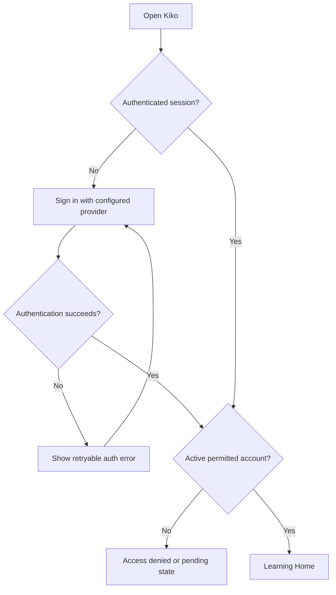
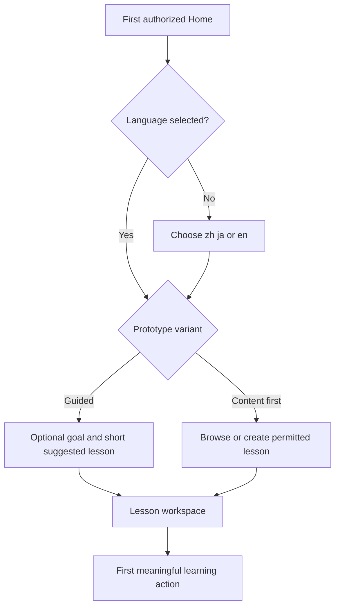
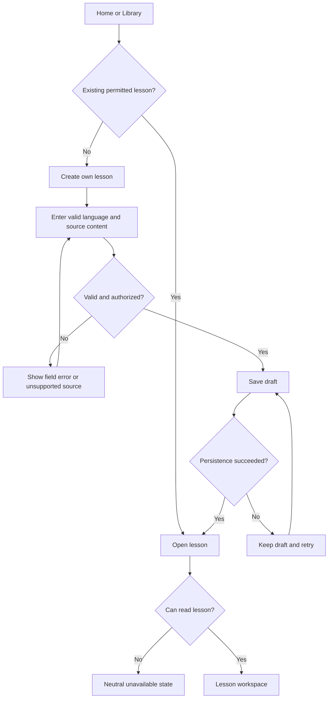
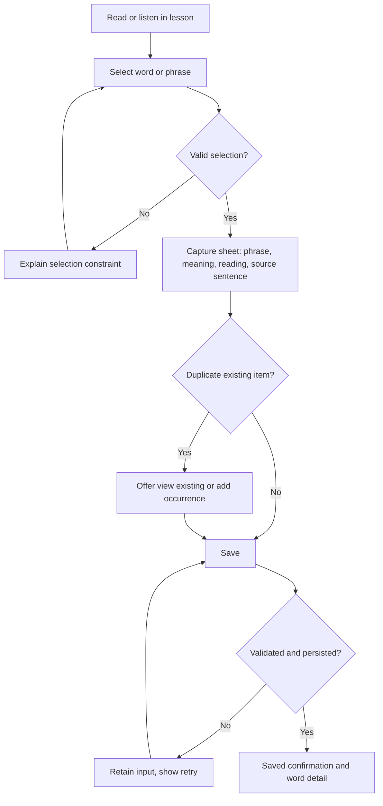
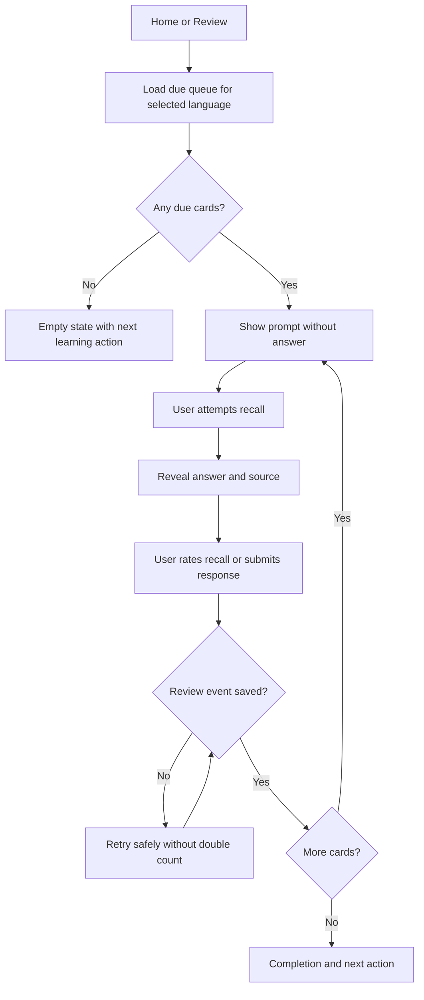
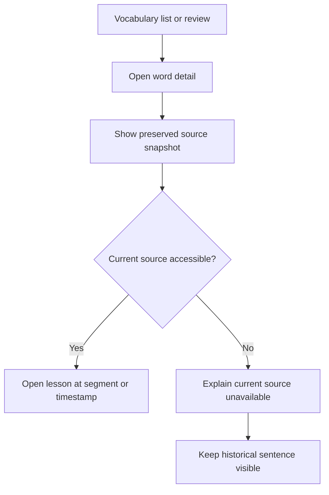
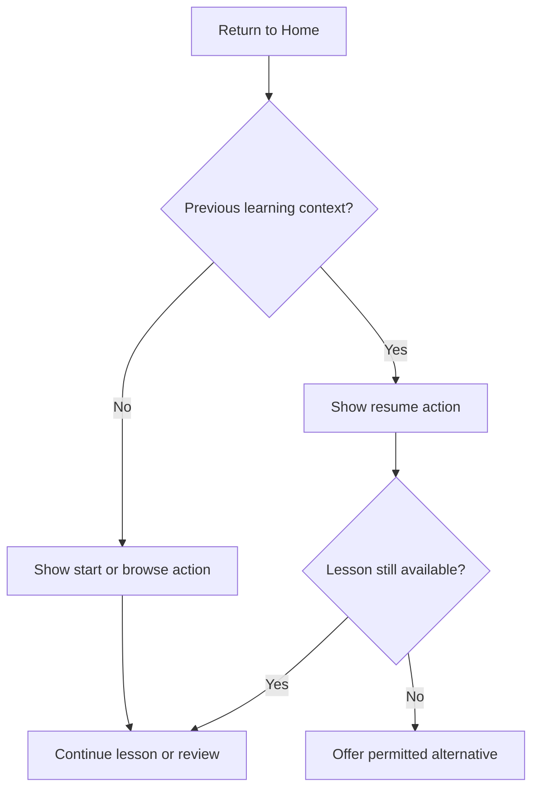
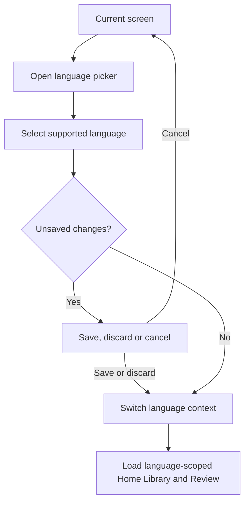
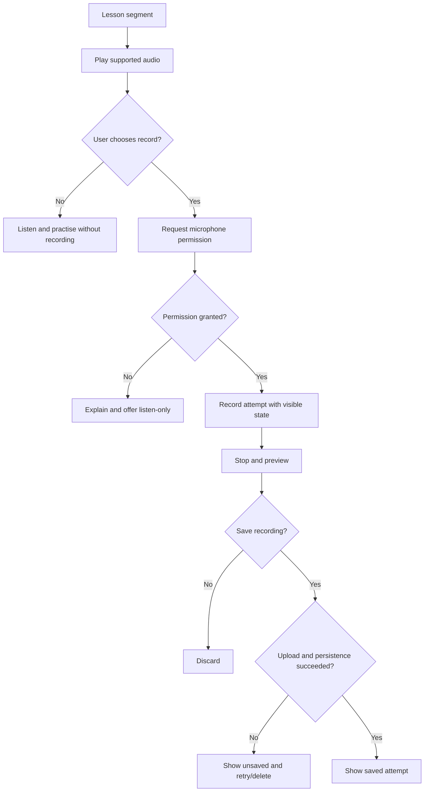
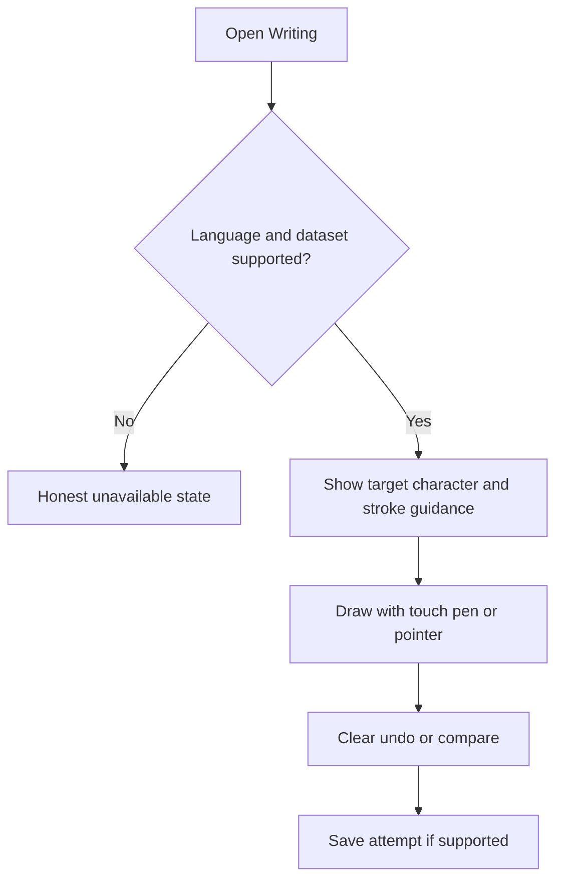

# Kiko — User Flows

**Version:** 0.1 | **Date:** 2026-10-19 | **Status:** UX draft, pending validation and approval
**Scope:** Responsive learning web, existing zh/ja/en technical baseline
**Inputs:** USER_RESEARCH_SYNTHESIS.md, PERSONAS_AND_JTBD.md, FEATURE_PRIORITIZATION.md, USER_JOURNEY_MAP.md, INFORMATION_ARCHITECTURE.md, UI_SPEC.md, ACCESS_CONTROL.md, PRD.md

## 1. Purpose and conventions

Define actionable screen-to-screen interactions for low-fidelity wireframes and usability tests. Flows represent **proposed behavior**, not confirmation that routes or functionality are implemented. Guided entry and gentle re-entry are experiments; AI speaking, live classes, payments and French/Korean are not newly approved MVP scope.

- **Actor:** active LEARNER; OWNER administration is a separate context.
- **P0:** core prototype; **P1:** supporting flow; **EX:** experiment.
- **Success:** persisted and confirmed action, not optimistic UI alone.
- **Private resource:** server-side ownership and admission checks on every read/write; inaccessible IDs must not reveal foreign content.
- **State:** distinguish draft, saving, saved, failed, cancelled, archived and due.

## 2. Flow inventory and traceability

| Flow | Priority | Primary persona/JTBD | Entry | Outcome | Screens |
|---|---|---|---|---|---|
| UF01 Sign-in and access | P0 | All | Sign-in | Authorized home or safe denial | Sign-in, access-denied, Home |
| UF02 First entry / language selection | EX/P0 language | PP01 / J01 | Home | First learning activity | Home, language picker, Library/Lesson |
| UF03 Open/create lesson | P0 | PP01/PP02 / J01/J02 | Home/Library | Lesson workspace | Library, editor, Lesson |
| UF04 Contextual vocabulary capture | P0 | PP02 / J03 | Lesson | Saved phrase with source | Lesson, capture sheet, word detail |
| UF05 Review and recall | P0 | All / J04 | Home/Review | Recorded review attempt | Review, completion |
| UF06 Return to source | P0 | PP02 / J03 | Vocabulary | Correct source context | Word detail, Lesson |
| UF07 Resume after break | P0/EX | PP01/PP05 / J05 | Home | Continued activity | Home, Lesson/Review |
| UF08 Switch learning language | P0 | PP06 / J08 | Header/Home | Correct language-scoped context | Picker, Home, Library/Review |
| UF09 Shadowing | P1 | PP03 / J06 | Lesson | Listen/record/retry | Lesson shadowing mode |
| UF10 Handwriting | P1 | PP06 / J08 | Writing/Lesson | Completed attempt | Writing |
| UF11 Progress and own-data controls | P1 | All | Progress/Settings | Understood metrics or data action | Progress, Settings |
| UF12 OWNER navigation | P1 | OWNER | Home | Authorized admin view | Admin pages |

## 3. UF01 — Sign-in and access (P0)

**Preconditions:** Visitor is unauthenticated or session has expired.

- **Success:** Learner sees own home and permitted content.
- **Errors:** Cancelled OAuth, network failure, expired session, suspended/unapproved account.
- **Security:** No account existence leakage, no protected content before admission, no automatic public sign-up assumption.
- **Acceptance:** Test both allowed and denied accounts and expired session.

## 4. UF02 — First entry: guided vs content-first (EX)

- **Experiment:** Compare two starts with PP01/PP02 participants. Goal entry must be editable/skippable.
- **Edge cases:** Unknown proficiency, no suggested lessons, user changes language, empty library, permission restrictions.
- **Do not assume:** Mandatory placement testing, new onboarding routes or dual modes in production.
- **Acceptance:** Participant reaches and understands first activity without facilitator guidance.

## 5. UF03 — Find, create and open a lesson (P0)

- **States:** Empty/filtered-empty library, loading, save pending, saved, error, unsupported media, draft changes.
- **Security:** User-created lesson remains private unless explicitly published under separate authorized workflow.
- **Acceptance:** Can open a permitted lesson or create a valid one; no false saved confirmation.

## 6. UF04 — Capture vocabulary with original context (P0)

- **Required data:** Language, phrase, optional reading, meaning, source sentence snapshot, lesson/version and optional media timestamp when available.
- **Duplicate behavior:** Must be explicitly specified before implementation; diagram shows a candidate, not an approved merge policy.
- **Errors:** Invalid selection, source changed, network failure, unauthorized lesson, duplicate, no translation.
- **Acceptance:** After reload, saved item retains correct source context; failed save does not appear as saved.

## 7. UF05 — Review and recall (P0)

- **State semantics:** Saved is not reviewed; reviewed is not necessarily recalled; due is scheduler-defined. Avoid unverified proficiency scoring.
- **Reliability:** Idempotent submission/retry and honest persistence state.
- **Acceptance:** Learner understands prompt/reveal sequence and review history is not double-counted.

## 8. UF06 — Return from saved phrase to source (P0)

- **Cases:** Lesson edited, archived, deleted or inaccessible; segment timing missing.
- **Security:** Historical context must be the learner's authorized own data, not a bypass to another user's lesson.
- **Acceptance:** Source is understandable even when current lesson version changed.

## 9. UF07 — Resume after interruption (P0 / EX)

- **Experiment:** Gentle wording and manageable due queue after missed days; no punitive streak design.
- **Cases:** No history, no due cards, source removed, language switched, unsaved draft.
- **Acceptance:** Learner finds a relevant next action and understands what remains.

## 10. UF08 — Switch learning language (P0)

- **Invariant:** Do not silently change a lesson's language or mix vocabulary/review/progress across languages.
- **Fallback:** Writing/shadowing tools appear only if supported for selected language.
- **Acceptance:** Correct language label, data and capabilities after switch; unsaved edits handled safely.

## 11. UF09 — Shadowing and recording (P1)

- **Consent:** Microphone permission is distinct from sending voice to an AI provider. No automatic AI transfer.
- **States:** Unsupported codec, no audio, denied permission, interrupted recording, upload failure, delete.
- **Acceptance:** User can distinguish local preview from server-saved recording.

## 12. UF10 — Handwriting (P1)

- No invented handwriting grade when recognition/scoring is unavailable.
- Ensure drawing does not block page scrolling outside the writing surface.

## 13. UF11 — Progress and own-data controls (P1)

- **Progress:** Home → Progress → choose language/period → view completed activities, saved items, review attempts and due counts. Sparse-data state explains what is missing; no inferred proficiency.
- **Export:** Settings → Own data → request export → show processing/success/failure → provide scoped result securely.
- **Delete:** Settings → select own data → explain consequences → explicit confirmation → server-side authorization → processing/completed/error status.
- **Restore:** Settings → validate allowed backup → preview conflicts → confirm → show partial/full result. Never overwrite unrelated data silently.
- **Privacy:** Distinguish recording storage from any optional external AI processing.

## 14. UF12 — OWNER navigation (P1)

Home → separate Administration entry (OWNER only) → Catalog / Access / System. Every operation is server-authorized, auditable and scoped. OWNER role does **not** grant automatic visibility into learners' private lessons or recordings. Unauthorized deep links return a safe denial without data leakage.

## 15. Shared UI states and design checklist

| State | Required behavior |
|---|---|
| Loading | Clear pending indicator; prevent duplicate actions where needed |
| Empty | Explain why nothing appears and provide an appropriate next action |
| Validation error | Identify correctable field/action; retain user input |
| Network failure | Keep local draft if safe; explicit retry |
| Save pending | Do not label as persisted |
| Save success | Confirm only after server acknowledgment |
| Session expired | Reauthenticate; avoid leaking private content |
| Permission denied | Neutral message without foreign resource metadata |
| Unsupported language/media | Explain capability limit and offer safe alternative |
| Unsaved work | Save/discard/cancel when leaving |
| Microphone denied | Preserve listen-only functionality |
| No due reviews | Do not invent cards; suggest another learning action |
| Reduced motion / accessibility | Keyboard and screen-reader friendly alternatives |

## 16. Prototype usability scenarios

1. **Beginner:** Sign in, select a language, find first lesson, complete a learning action, explain next step.
2. **Content-led:** Find a lesson, select phrase, save with context, review, reopen source.
3. **Error recovery:** Simulate failed save or unsupported media and continue without losing data.
4. **Language switch:** Switch languages while a draft is unsaved and verify correct queue.
5. **Return:** Resume after a simulated break with no due cards.
6. **Consent:** Explain when a recording is local, saved or transmitted externally.

Record completion, misnavigation, hesitation, error recovery and comprehension; do not invent quantitative results. Suggested exploratory sample: 8–12 participants across PP01 and PP02.

## 17. Open decisions and handoff

- Confirm pilot language and target persona before hi-fi content production.
- Decide duplicate vocabulary occurrence behavior, review rating labels and restore conflict policy.
- Test guided vs content-first onboarding; do not commit both without evidence.
- Reconcile proposed route names and behaviors with actual code before implementation.
- Next: low-fi wireframes for UF01–UF08, then responsive and accessibility checks, usability tests, and hi-fi UI.

**Change control:** Documentation-only UX proposals. No new scope, permissions, database migrations, deployments or backlog changes are authorized.
